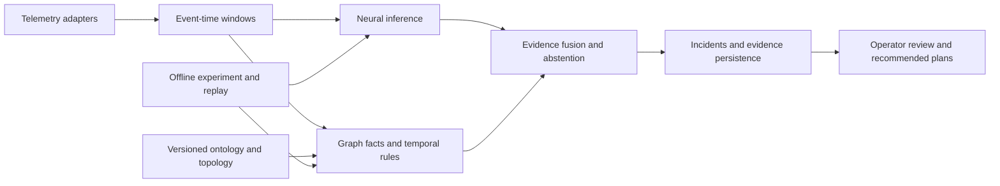

# DCE architecture and implementation boundary

The repository root is the requested DCE project root; no additional nested DCE checkout is created.

## Current implementation

[dce-r0/dce](dce-r0/dce/README.md) is the delivered research package: synthetic datasets,
aligned offline windows, scikit-learn temporal MLP training, NumPy scoring, NetworkX rules,
evidence fusion and evaluation. It has not been migrated into src/ by this scaffold.
Original root notebooks remain historical inputs. New notebooks belong in notebooks/.

## Target architecture

src/ contains reserved module boundaries, not runtime implementations. Models, replay datasets,
simulation and evaluation artifacts are separated from source and linked by manifests.
API, durable ingestion, online state ownership, database, console and deployment remain planned.
See [TECH_STACK](docs/TECH_STACK.md) and [implementation plan](docs/IMPLEMENTATION_PLAN.md).

## Scientific contracts

Raw physical observations feed rules; versioned model features feed inference. Every decision pins
input, feature, graph, model, rule and fusion versions. A -> B means A depends on B.
Topology-supported hypotheses are not proof of causal effects; intervention experiments have a separate contract.
Research work flows through [experiment records](EXPERIMENT_INDEX.md) before substantial changes.
