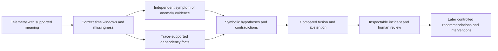

# DCE progress report and complete implementation–experiment plan

**As of 8 October 2026 · Asia/Calcutta.** Prepared from live workspace records and source inspection for the user's progress-report request. This is a new dated synthesis, not a scientific approval, replacement register, new experiment allocation or permission to execute future work.

## 1. The answer first

We have reproduced the original synthetic baseline, tested a timing change that gave no improvement, recovered and narrowly accepted a real-data representation/replay foundation, and completed a restricted graph-ranking experiment. We also have a local telemetry intake engineering slice and a readable research-results frontend.

**We have not yet established reliable fault detection, root-cause diagnosis, hybrid superiority, causality, safe action selection or a deployable production system.** Four permanent experiments have execution evidence; that is not four production milestones passed.

My recommendation is to **review E004's REVISE / structural-prior-only proposal**, retain its negative comparison, and then—only with reviewed scope—design a small qualification of trustworthy symptom evidence. Before a model learns from telemetry, we need to know which measurements have supported meaning, which signals can be distinguished from normal variation, and which components are observable.

E002-R002's separate REVISE proposal also awaits review. E003's infrastructure acceptance does not approve these decisions or every downstream stage.

## 2. What the project is intended to become

The original product direction is an attachable neuro-symbolic system for distributed-service incident investigation: collect telemetry, form correct time windows, detect abnormal behavior, combine it with dependency and timing evidence, rank possible origins, explain uncertainty, and recommend reviewed actions. Controlled remediation and self-healing are later research stages.

The three tracks run together:

| Track | Work | Evidence needed |
|---|---|---|
| System building | Telemetry, representation, windows, graphs, inference, persistence and interfaces | Actual executable behavior and integration/recovery checks |
| Controlled research | Hypotheses, independent references, frozen controls, runs and evaluation | Recorded results, negative cases, leakage checks and uncertainty |
| Documentation/review | Provenance, experiment reasoning, interpretation and decisions | Dated records and human approval of the specific next scope |

The initial product defaults in the [PRD](docs/PRD.md) are recommendation-only, self-hosted Linux containers, CPU inference, metrics for perception, traces for topology and manual model promotion. A later research goal of self-healing does not change today's authority or safety boundary.

The intended flow is:

Today, representation/replay and a restricted structural ranking path exist. The complete chain above has not been qualified end to end.

## 3. Which earlier plans govern this report?

There are two preserved planning layers:

1. The [2 October implementation plan](docs/IMPLEMENTATION_PLAN.md) and [technology proposal](docs/TECH_STACK.md) describe delivery architecture, engineering packages, six later delivery phases plus foundation, and proposed release targets.
2. The [laboratory constitution](EXPERIMENTAL_PROTOCOL.md), [execution roadmap](docs/governance/EXECUTION_ROADMAP.md), [machine plan](docs/governance/execution-plan.json) and stage cards organize research into **P00–P20 and XP001–XP038**. Research gates govern future sequencing; the earlier engineering schedule cannot bypass them.

The [reconciliation](docs/governance/RECONCILIATION.md) preserves differences rather than rewriting either plan. Original program E-labels are historical planning labels. **XP IDs are not permanent experiment IDs.** E001 = baseline reproduction; E002 = timing analysis; E003 = domain adequacy; E004 = restricted symbolic baseline through its [additive registration](EXPERIMENT_INDEX_AMENDMENT_2026-10-06_E004.md).

October 3 checkpoints and some root docs still describe an earlier blocked/draft state. Read them with the [6 October E003 approval](docs/governance/amendments/2026-10-06-E003-V006-acceptance-and-E004-scope.md), [E004 registration](docs/governance/registrations/E004.json) and [later checkpoint](PROJECT_STATE_2026-10-06_E004.md). No broad phase gate approval is inferred from those amendments.

The sequence below is the recovered original program. Section 7 is **my proposed next-step recommendation**, not something already approved.

## 4. Completed experiments: what happened and what it means

| Permanent identity | Question | Execution and measured result | Meaning and remaining decision |
|---|---|---|---|
| E001-R001 | Can we reproduce the delivered R0 simulation? | CLI completed; five comparable report tables matched after output-path normalization. | One-host seeded reproduction established. Hybrid superiority not established. User acceptance of REVISE is reported in the handoff/presentation notes; dedicated approval provenance is incomplete. |
| E002-R001 | Does consistent onset timing improve ranking? | Three repeats agreed; treatment switch worked; ranking gain zero; environment qualification failed. | Negative synthetic result retained. R001 acceptance is reported by handoff/presentation notes. |
| E002-R002 | Does the same result survive a qualified environment? | Pre/postflight qualified; 49 tests passed; raw results identical to R001; Top-1 difference 0.000 over 237 events. | Environment fix did not produce ranking improvement. Its separate REVISE proposal remains pending review. |
| E003-R001 and AM002 recovery | Can real telemetry be represented and replayed faithfully? | Initial bounded adequacy failed to establish readiness. V006 recovered 162 inherited profiles; 335/335 windows verified in each replay; independent audit over 670 projections passed. | Accepted only as representation/replay infrastructure. Scientific disposition remains REVISE / restricted readiness. |
| E004-R001 | Does dependency structure help locate the fault beyond non-graph references? | All 335 windows processed twice; engineering/audit gate passed; graph scored below observation counts. | Restricted structural signal, insufficient reliable localization. REVISE / structural-prior-only proposal awaits human review. |

### E001: preserve the difference between a reproducible CLI and passing tests

The [result summary](experiments/E001/results/E001-R001/SUMMARY.md) establishes report reproduction. The [execution log](experiments/E001/logs/E001-R001.md) also records **25 original R0 tests passed, 1 failed, 2 errored**: an in-memory model-version defect and Windows temporary-directory failures. The CLI saved/reloaded its model and succeeded.

The “47 tests passed” cited in the older frontend belongs to a separate [OTLP engineering workspace check](docs/engineering/otlp-intake-implementation.md). It does not erase R0's recorded failures. This is one reproduction, not a multi-host reproducibility estimate.

### E002: a useful negative result

R002 retained the frozen synthetic timing question. Mixed timing used 306 cross-source pairs; same-source timing used none. The switch changed the treatment, yet ranking did not improve. This tests that timing policy in that simulator; it does not demonstrate every temporal or hybrid method is useless.

Evidence: [R002 summary](experiments/E002/results/E002-R002/summary.json), [validation](experiments/E002/results/E002-R002/validation.json), [comparison](experiments/E002/results/E002-R002/comparison-r001-r002.md) and [pending proposal](experiments/E002/results/E002-R002/decision-proposal.md). Portable reconstruction from downloaded hash-pinned wheels was not established; verified local packages were used after package-index DNS failure.

### E003: technical recovery is real; semantic limits are real too

| Preserved attempt | Recorded state |
|---|---|
| Initial R001 | Eight bounded scope replays; 2,000-row-per-file prefixes; scientific adequacy not established |
| AM002 V002 | Partial: 77/162 profiles |
| V004 | 162 profiles; interrupted during Replay 1 |
| V005 | Failed engineering attempt |
| V006 | Controlled recovery completed; earlier attempts preserved |

V006 inherited the profiles; it did not rescan the raw dataset. Replay 1 reused 164 valid V004 artifacts and reconstructed 171. Replay 2 verified all 335 again; canonical/graph hashes agreed. The launcher returned status 1 with an environment warning while completed artifacts were independently verified.

Permanent limits: **B and D were not retested**, 7,956 metric registry entries remain UNKNOWN, roots were seen in telemetry for 285/335 cases and in before-only inputs for 284/335, and query associations are qualified for 333 with 2 UNKNOWN. These counts describe coverage, not accuracy. Supplied fault times define retrospective windows; this is not online incident detection.

Evidence: [V006 summary](experiments/E003_domain_model_adequacy/qualification/2026-10-04/results/V006/summary.json), [audit](experiments/E003_domain_model_adequacy/qualification/2026-10-04/results/V006/independent-audit.json), [scientific proposal](experiments/E003_domain_model_adequacy/qualification/2026-10-04/results/V006/decision.md) and [limited acceptance](docs/governance/amendments/2026-10-06-E003-V006-acceptance-and-E004-scope.md). The decision file contains a JSON-serialized Markdown string; its extension does not change its scientific status.

### E004: what the first real-data ranking comparison found

| Fixed method | Primary Top-1 | Primary Top-3 | Plain explanation |
|---|---:|---:|---|
| Shared-dependency graph heuristic | 3.08% | 8.93% | Rank components reached by many other observed callers |
| Observation-count reference | 4.78% | 14.93% | Rank components by recorded telemetry volume |
| Graph-disabled uniform reference | 1.80% | 5.41% | Give each observed candidate equal score |

All 335 windows stay in the denominator, including 51 where the labelled root is absent. Tied candidates share expected credit. Secondary lexical tie ordering must not replace the preregistered primary scores.

Two ranking computations agreed for every case; 27 fixture tests and the stored independent audit passed. Predictions were sealed before execution evaluator label parsing. This is a structural prior without a qualified symptom detector. A heavily shared dependency need not be broken, and observation volume is not abnormality. Descriptive intervals do not establish statistical significance under dependent/overlapping windows.

Evidence: [protocol](experiments/E004_symbolic_rca_baseline/protocol.md), [summary](experiments/E004_symbolic_rca_baseline/results/E004-R001/summary.json), [independent audit](experiments/E004_symbolic_rca_baseline/results/E004-R001/independent-audit.json) and [pending decision](experiments/E004_symbolic_rca_baseline/results/E004-R001/decision.md).

## 5. What is implemented, versus what is only intended?

| Capability | Live source/artifact evidence | Current boundary |
|---|---|---|
| Delivered synthetic neural/rule/fusion baseline | [R0 package](dce-r0/dce/README.md), E001/E002 artifacts | Historical executable baseline; not an independently qualified real-data hybrid |
| Canonical representation, time and typed graphs | [foundation package](src/dce_foundation/), [representation v2](src/dce_foundation/representation_v2/) | Implemented experimental representations; semantic UNKNOWN states remain |
| Source profiling, incident retrieval, isolated projection and replay | [qualification package](src/dce_foundation/qualification/), V006 evidence | Reproducible retrospective replay; not a live symptom detector |
| Structural ranking and explanations | [symbolic E004 source](src/dce_foundation/symbolic_e004.py) | Shared-dependency, count and uniform references; scores are not probabilities |
| Local OTLP binary metrics/traces receiver | [intake source](src/dce_foundation/ingest/app.py), [engineering note](docs/engineering/otlp-intake-implementation.md) | FastAPI + SQLite receipt log/replay; documented real direct SDK path. Collector path, auth/TLS, logs, throughput and production recovery unqualified |
| Current research-results cockpit | [cockpit](frontend/research-cockpit/CURRENT_RESULTS.md) | Recorded experiment viewer; not runtime incident management |
| Additive readable notebook preview | [reader](frontend/research-reader-2026-10-08/README.md), [frontend audit](docs/FRONTEND_AUDIT_2026-10-08.md) | Experiment reasoning, original design records, pending reviews and evidence; existing-file integration not authorized |
| Real-data feature pipeline and independent neural detector | Contracts/proposals and historical prototypes | No newly qualified training/serving chain established |
| Full symbolic reasoning/fusion/abstention | Reasoning and evaluation contracts; historical R0 code | General time/domain/contradiction/root-set behavior and real-data hybrid contribution unqualified |
| Incident lifecycle API, worker queue, notifications, feedback | PRD/implementation proposals | No qualified product implementation established by this report |
| Container deployment, identity/access, backup/restore, scale | [deployment boundary](deployment/README.md), proposed stack | Not qualified; no clean install or operational pilot verified here |
| Causal/counterfactual reasoning, planning and remediation | Scientific contracts and future stage cards | Future controlled research, no established capability |

Source presence, stored run checks and current browser checks are different kinds of evidence. This report does not launch services, run inference, retrain models or repeat scientific evaluations.

The intended stack remains Python/FastAPI, typed contracts, NetworkX, offline training and ONNX Runtime serving, PostgreSQL for pilot persistence/queue, a later operator console and Linux containers. The implemented SQLite intake slice is not the proposed PostgreSQL incident/worker platform. Dependencies listed in a proposal are not proof they are installed or runtime-ready. Kafka is conditional on measured need; an LLM explanation layer is optional and cannot invent evidence.

## 6. Complete recovered phase plan

The table gives the original phase objective and today's evidence boundary. Broad phase approval remains separate from narrower experiment or engineering progress; no completion percentage is assigned.

| Phase | Intended implementation/research objective | Current evidence boundary |
|---|---|---|
| P00 — Research definition | Connect each component to RQ1–RQ8 and measurable evidence; review G0 before architecture claims. | Constitution, questions, contracts and registers exist; no blanket G00 approval recorded. |
| P01 — Formal world model | Review entities, relations, observations, events, state, evidence, hypotheses, rules, constraints, actions and causal-model contracts. | E003 foundation implemented; V006 accepted for representation/replay only; full scientific adequacy unresolved. |
| P02 — Dataset and experimental environment | Establish versioned real telemetry plus a separately controlled fault-injection environment; distinguish replay from intervention capabilities. | OpenRCA manifests and replay evidence exist; controlled live fault-injection environment not qualified. |
| P03 — Experimental distributed system and ingestion | Use minimal instrumented services and trustworthy telemetry attachment before downstream experiments; no production platform expansion. | Local OTLP/HTTP + SQLite attachment slice documented; full Collector/testbed ingestion gate not qualified. |
| P04 — Temporal representation | Prove event-time alignment, windows, masks, missing/reset/late and membership semantics before learned models. | Timestamp profiles and retrospective cutoff projections implemented; full online alignment/lateness/reset gate not qualified. |
| P05 — Dynamic distributed-system graph | Validate typed relation direction, cycles, shared dependencies, scoped identities and topology provenance. | Trace-supported typed graphs and E004 certificate checks exist; general dynamic-topology gate not qualified. |
| P06 — Pure symbolic baseline | Establish topology, time, domain rules, contradictions and multiple-root baselines without neural leakage. | E004 restricted graph-only baseline executed; REVISE proposal pending; time/rule/contradiction/multi-root campaign incomplete. |
| P07 — Neural anomaly evidence | Validate held-out incident detection, preprocessing, ONNX parity and changing memberships after symbolic baselines. | Historical notebook/R0 neural work exists; no newly qualified real-data neural baseline or serving path established. |
| P08 — Evidence fusion | Demonstrate independent component contributions through matched baselines and ablations. | Historical R0 fusion exists; independent real-data hybrid contribution remains unproven. |
| P09 — Causal reasoning | Distinguish observations/hypotheses/causality with documented assumptions and controlled interventions. | Planned; no qualified implementation or reviewed completion established in this report. |
| P10 — Counterfactual reasoning | Test predicted alternative worlds against controlled intervention outcomes and limits. | Planned; no qualified implementation or reviewed completion established in this report. |
| P11 — Symbolic planning | Define state/action preconditions/effects/goals and reject constraint-violating plans; compare declared objectives. | Planned; no qualified implementation or reviewed completion established in this report. |
| P12 — Controlled remediation | Require safety checking and explicit human approval, then verify actual transitions and failed recovery in isolated testbeds. | Planned; no qualified implementation or reviewed completion established in this report. |
| P13 — Self-healing | Only enable bounded closed-loop autonomy after reviewed diagnosis, planning, safety, execution and verification evidence. | Planned; no qualified implementation or reviewed completion established in this report. |
| P14 — Neuro-symbolic integration | Validate event extraction, bounded hypothesis generation and symbolic rejection of unsupported neural claims. | Planned; no qualified implementation or reviewed completion established in this report. |
| P15 — Distributed production architecture | Qualify persistence and scope ownership before API/workers/deployment; Kafka only for measured need. | Planned; no qualified implementation or reviewed completion established in this report. |
| P16 — Frontend and operator experiments | Build an operator evidence interface after backend qualification; test usability and uncertainty without UI becoming reasoning truth. | Recorded-results cockpit and additive reader implemented; live operator console and operator experiment gate not qualified. |
| P17 — Final evaluation campaign | Compare detection/statistical, topology, temporal, neural, fusion and causal/counterfactual baselines under identical held-out conditions. | Planned; no qualified implementation or reviewed completion established in this report. |
| P18 — Robustness campaign | Challenge missing/late/duplicate/incorrect data, partial traces, membership/topology changes, novel faults, contradictions and process/DB/network failures. | Planned; no qualified implementation or reviewed completion established in this report. |
| P19 — Global ablation matrix | Remove neural, topology, temporal, rules, causal, counterfactual, fusion and constraints independently; measure real contributions. | Planned; no qualified implementation or reviewed completion established in this report. |
| P20 — Final research report | Synthesize reproducible experiment evidence, baselines, ablations, failures, limitations, validity threats and decisions; do not replace negative results with narrative. | Planned; no qualified implementation or reviewed completion established in this report. |

The later campaigns deliberately revisit earlier components under matched controls, stress and ablations; they are not redundant paperwork. A component that adds no measurable benefit may be revised or abandoned instead of being implemented merely to complete a diagram.

## 7. Recommended next steps, with decision gates

### Step 1 — close the immediate human review

Review E004 with this concrete proposal: **retain E004 as reproducible structural-prior evidence; accept its technical execution; retain REVISE for diagnostic readiness; acknowledge that it scored below counts; do not claim superiority or operational RCA.**

Review E002-R002's unchanged negative result and qualified local environment separately. If accepted, record new dated approval amendments with the user's actual scope and date, rather than editing the proposals. E001/R001 and E002/R001 approval provenance could also be made explicit through user-reviewed additive records; no backdated approvals should be invented.

**Output:** clear review records and the exact permitted next scope. The present request commissions this report; it does not itself accept those proposals.

### Step 2 — review a bounded symptom-evidence qualification design

Recommended question: **Can a declared, telemetry-only policy identify abnormal behavior in an observable component, distinguish it from normal workload/collection variation, and supply supported evidence to a later ranking comparison?**

This is a proposed new scope, not a registered experiment and not a repair of E004 after seeing its results.

Preparation should define:

- A small feature catalogue with source evidence for identity, units, temporality, sampling, reset and missingness. Qualify only what the evidence supports; leave everything else UNKNOWN.
- Whether available pre-cutoff observations and genuine normal controls are sufficient. If not, propose separately approved controlled testbed acquisition; a single fault-conditioned replay window is not automatically a healthy baseline.
- Operational input eligibility and candidate rules that are label-independent. Report the complete registered population and excluded/abstained cases; never hide root-absent failures.
- A simple independent reference, then a symptom-aware rule challenger on identical inputs. Reuse E004 only as a frozen comparator where input/evaluation compatibility is justified.
- A detection question separate from a localization question. Fault-time-conditioned windows may support bounded retrospective analysis; they cannot establish online detection.
- A new train/calibration/test policy before substantive development. All 335 E004 cases have already been examined; reusing them is exploratory, not a fresh held-out confirmation. Group dependent/overlapping windows and environments appropriately; collect genuinely new evidence if no credible independent holdout is available.
- Explicit metrics and acceptance criteria before execution: symptom validity/coverage, missingness/abstention, event false positives with exposure, localization scores when applicable, uncertainty valid for the population, and repeatability/leakage checks. Numeric thresholds are a review decision, not invented here.

**Output before execution:** reviewed protocol, controls, dataset/code/config/environment provenance, independent references, leakage tests and a frozen evaluation policy. Allocate an experiment identity only through reviewed registration. No raw-data rescan is needed merely to write this design.

If evidence cannot support symptoms, record inadequacy and request a reviewed data/testbed branch. Do not feed UNKNOWN units or answer-bearing aliases into a model to manufacture apparent progress.

### Step 3 — establish the simplest defensible diagnostic comparison

After successful qualification and authorization, compare the symptom evidence alone with symptom-plus-topology on matched inputs. Add timing or domain constraints only as independently evaluated contributions. Include wrong-topology/negative controls, ambiguous cases, contradictions, missing evidence and multiple candidate origins within the approved scope.

**Output:** first measured evidence that a diagnosis-related signal exists and whether structure adds value. An unsuccessful comparison is a valid stopping/revision point. Graph reachability remains an observed dependency relationship, not an established causal mechanism.

### Step 4 — neural work after the required symbolic/data gates

Then review a real-data neural anomaly baseline with distinct per-component signals, train-fitted preprocessing, chronological/grouped splits, missingness masks, an independent statistical reference and separate detection/forecasting tasks. Verify actual inference and PyTorch/ONNX numerical and decision parity before serving claims. Service membership and topology changes need their own controls.

**Output:** reproducible model and held-out detector evidence. Historical notebook execution does not pass this gate.

### Step 5 — prove hybrid contribution before platform expansion

Compare independent symptom/statistical, neural-only, symbolic-only and combined methods at matched alert budgets and tuning budgets. Remove neural/topology/time/rules separately; measure calibration only if probability claims are made; preserve explicit abstention.

**Output:** contribution report. If hybrid does not outperform the stronger independent reference, keep that stronger reference and revise or abandon the extra complexity. Do not call a shared graph/fusion branch an independent neural baseline.

### Step 6 — engineering release path and later controlled research

With reviewed backend evidence, build persistent incident/API/worker behavior, real Collector attachment, operator evidence workflows, feedback and recommendation-only runbooks. Prove restart, idempotency, stale-worker rejection, isolation, restore and rollback behavior before distributed scaling.

Causal and counterfactual claims require identified assumptions and controlled interventions. Action planning requires preconditions/effects, safety constraints, approval, post-action verification and rollback. Self-healing follows those gates, not a frontend milestone.

**Output:** a deployable research demonstrator first, then a qualified shadow pilot and release decision. Production readiness requires both scientific and operational evidence.

### Work that remains safe to pursue as documentation/review

Improve source-linked progress summaries, surface the two pending decisions, draft reviewed protocols and inspect stored failure cases without tuning frozen methods. Integrating the new reader into existing presentation files needs explicit existing-file edit authority. Research execution and infrastructure changes require separate scope.

## 8. Engineering milestones from the earlier delivery plan

| Earlier milestone | Intended deliverable | Progress today |
|---|---|---|
| M0 | Reproducible simulator and contracts | R0 reproduction and foundational contracts exist; repaired simulator/complete fixture and packaging gates are not all qualified |
| M1 | Offline neuro-symbolic replay with genuine neural invocation and independent ablations | Historical R0 path exists; real-data replay + structural comparison exist; new real-data hybrid acceptance is not achieved |
| M2 | Containerized persistent API | Local intake is a smaller engineering slice; full persistent incident/worker API and clean container install unqualified |
| M3 | Real testbed connection and operator console | Direct SDK intake demonstrated in stored engineering record; Collector/live fault-to-incident flow and operator console unqualified |
| M4 | Recovery, security and load qualification | Scientific replay recovery is evidence, but not worker/production/security/load qualification |
| M5 | Shadow pilot and release | Not established |

The original estimate assumed two backend/platform engineers, one ML engineer and part-time SRE/security review, with approximately 16–24 engineering weeks plus a 30-day shadow pilot. It is a dated proposal, not an elapsed-time progress measure or a current commitment. Remaining schedule must be re-estimated after the symptom/data gate, available people, hardware and testbed access are known.

The PRD's proposed precision/recall, ranking, hybrid-gain, latency, availability and restore targets remain **unratified qualification targets**. E004's narrow retrospective results cannot be treated as a directly comparable production gate. The earlier ≥100 controlled faults, seven fault-free days and 30-day pilot requirements remain planned release evidence.

## 9. Blockers and risks to keep visible

| Gap | Practical implication | Recommended response |
|---|---|---|
| 7,956 UNKNOWN metric meanings | Unsupported features/SLO thresholds would give misleading symptoms | Qualify a bounded evidenced subset; keep unknowns explicit |
| 51 absent-root candidate cases in E004 | Ranking cannot select a missing component | Preserve denominator; study coverage and identity provenance without label-based filtering |
| No qualified symptoms in E004 | Sharedness/volume cannot tell us something is broken | Proposed symptom-evidence qualification |
| Fault-time-selected retrospective windows | Does not show when an online detector would fire | Separate retrospective and independently evaluated online detection protocols |
| Dependent/overlapping windows | Naive intervals or random splits overstate certainty | Preregister grouped/time/environment holdouts and appropriate uncertainty |
| All E004 cases already inspected | Reusing them for tuning and confirmation leaks evaluation knowledge | Mark reuse exploratory; obtain untouched independent confirmation |
| Sparse dedicated review provenance for E001/E002 | Presentation acceptance is less auditable than E003's dated record | Add user-reviewed amendments; never invent approvals |
| Live dataset location/backup not refreshed | Data operations might fail or endanger evidence | Verify only when needed; no deletion/migration without separate authority and restore evidence |
| Intake dependencies/packaging and full deployment not qualified | Existing local success does not imply clean installation | Later environment/package and clean-install qualification |
| Historical documents remain stale by design | Readers may mistake old state for current authority | Link dated amendments/checkpoints and explain precedence |
| Frontend snapshot does not auto-detect later record changes | A readable screen can become out of date | Future reviewed registration-driven inventory/hash freshness checks |

## 10. How future progress should be recorded

For each approved scope retain: question, hypothesis, why it is needed, independent references, variables/controls, acceptance criteria, dataset/code/config/environment hashes, run identity, execution status, raw results, failed cases, interpretation, limitations, review status and exactly permitted next scope.

Use new dated reports/amendments while preservation remains in force. Keep **implemented**, **executed**, **measured**, **independently checked**, **human approved**, and **production qualified** distinct. Do not turn roadmap rows into percentages or force every planned component to survive a negative experiment.

## 11. Full 38-stage experiment-planning inventory

These are the original planning stages from execution-plan.json, not registered future E-number experiments. Dependencies are planning prerequisites; card status remains preserved historical evidence and narrow additive approvals do not silently rewrite it.

| Planning stage / phase | Test or implementation purpose | Planning prerequisites | Independent reference / comparison | Measures | Current boundary |
|---|---|---|---|---|---|
| [XP001 — Domain model adequacy](docs/governance/stages/XP001-domain-model-adequacy.md) / P01 | Domain model adequacy | Research-definition review | Source rows/schema as oracle; cross-scenario fixtures | source fidelity; special-case fields; reconstruction completeness | E003: infrastructure accepted only; scientific adequacy restricted. |
| [XP002 — Telemetry attachment](docs/governance/stages/XP002-telemetry-attachment.md) / P03 | Telemetry attachment | XP001 | Known emitted payloads versus received durable records | malformed/retry rates; acknowledgment durability; identity/unit fidelity | Engineering slice documented; complete registered qualification not established. |
| [XP003 — Real feature coverage](docs/governance/stages/XP003-real-feature-coverage.md) / P03 | Real feature coverage | XP002 | Actual source catalogue; no assumed notebook columns | metric coverage; units; temporality; distinct aligned windows | Metric inventory exists; 7,956 semantics UNKNOWN; feature adequacy unresolved. |
| [XP004 — Temporal correctness](docs/governance/stages/XP004-temporal-correctness.md) / P04 | Temporal correctness | XP003 | Same event set with permuted arrival order; offline oracle | online/offline equality; missing/reset/late handling | Retrospective cutoff/replay evidence exists; full online gate not established. |
| [XP005 — Graph correctness](docs/governance/stages/XP005-graph-correctness.md) / P05 | Graph correctness | XP004 | Known controlled topology and independently specified expected paths | direction/reference fidelity; cycles; shared roots; impact coverage | Typed trace graph and independent E004 checks exist; full stage gate not established. |
| [XP006 — Topology-only baseline](docs/governance/stages/XP006-topology-only-baseline.md) / P06 | Topology-only baseline | XP005 | Structural-only baseline; frozen incidents and symptom input policy | Top-1/Top-k/root-set localization; explanation coverage | E004 is related narrow evidence; it does not auto-pass this planning card. |
| [XP007 — Topology plus temporal reasoning](docs/governance/stages/XP007-topology-plus-temporal-reasoning.md) / P06 | Topology plus temporal reasoning | XP006 | XP006 with identical incidents and tuning budget | localization delta; temporal consistency; abstention | E002 synthetic timing is related evidence; not execution of this real-data stage. |
| [XP008 — Topology temporal domain rules](docs/governance/stages/XP008-topology-temporal-domain-rules.md) / P06 | Topology temporal domain rules | XP007 | XP007; fixed rules and held-out incidents | localization delta; rule/path accuracy | Planned; no registered execution/completion established for this stage. |
| [XP009 — Contradiction handling](docs/governance/stages/XP009-contradiction-handling.md) / P06 | Contradiction handling | XP008 | XP008 with/without explicit observed-healthy evidence | contradiction rejection; abstention; false diagnosis | Planned; no registered execution/completion established for this stage. |
| [XP010 — Multiple simultaneous symbolic faults](docs/governance/stages/XP010-multiple-simultaneous-symbolic-faults.md) / P06 | Multiple simultaneous symbolic faults | XP008 | Known multi-fault interventions versus single-fault controls | root-set accuracy; collapse rate; ambiguity | Planned; no registered execution/completion established for this stage. |
| [XP011 — Neural anomaly baseline](docs/governance/stages/XP011-neural-anomaly-baseline.md) / P07 | Neural anomaly baseline | XP009, XP010 | Independent statistical/detection baseline; chronological splits | incident precision/recall/F1; delay; false positives | Historical R0/neural prototypes only; stage remains unqualified. |
| [XP012 — PyTorch ONNX parity](docs/governance/stages/XP012-pytorch-onnx-parity.md) / P07 | PyTorch ONNX parity | XP011 | Same weights/preprocessing/inputs in PyTorch and ONNX Runtime | numerical/decision parity; CPU latency; boundary correctness | Historical parity evidence does not qualify a new real-data serving model. |
| [XP013 — Variable service membership](docs/governance/stages/XP013-variable-service-membership.md) / P07 | Variable service membership | XP012 | Fixed model/version controls; 8/12/20-service held-out scenarios | quality across memberships; mismatch rejection; adaptation | Planned; no registered execution/completion established for this stage. |
| [XP014 — Fusion ablation](docs/governance/stages/XP014-fusion-ablation.md) / P08 | Fusion ablation | XP013 | Neural-only, symbolic-only, neural+graph, +time, full fusion | Top-1/Top-k/path accuracy; false diagnosis; abstention; coverage | Historical fusion comparisons do not qualify this independent ablation campaign. |
| [XP015 — Remove neural evidence](docs/governance/stages/XP015-remove-neural-evidence.md) / P08 | Remove neural evidence | XP014 | Frozen full-fusion model versus truly disabled neural branch | quality/calibration/explanation delta | Planned; no registered execution/completion established for this stage. |
| [XP016 — Remove topology](docs/governance/stages/XP016-remove-topology.md) / P08 | Remove topology | XP014 | Frozen full fusion versus graph-disabled path | localization/explanation delta | Planned; no registered execution/completion established for this stage. |
| [XP017 — Remove temporal evidence](docs/governance/stages/XP017-remove-temporal-evidence.md) / P08 | Remove temporal evidence | XP014 | Frozen full fusion versus temporal-disabled path | onset/localization/abstention delta | Planned; no registered execution/completion established for this stage. |
| [XP018 — Correlation versus causal hypothesis](docs/governance/stages/XP018-correlation-versus-causal-hypothesis.md) / P09 | Correlation versus causal hypothesis | XP015, XP016, XP017 | Correlated noncausal and controlled causal scenarios | mechanism discrimination; causal false-positive rate | Planned; no registered execution/completion established for this stage. |
| [XP019 — Controlled intervention](docs/governance/stages/XP019-controlled-intervention.md) / P09 | Controlled intervention | XP018 | Injected DB saturation versus no saturation under matched workload | intervention consistency; downstream effect differences | Planned; no registered execution/completion established for this stage. |
| [XP020 — Causal model comparison](docs/governance/stages/XP020-causal-model-comparison.md) / P09 | Causal model comparison | XP019 | Observational correlation versus explicit structural model | causal effect/path accuracy; sensitivity to assumptions | Planned; no registered execution/completion established for this stage. |
| [XP021 — Counterfactual root-cause test](docs/governance/stages/XP021-counterfactual-root-cause-test.md) / P10 | Counterfactual root-cause test | XP020 | Observed worlds and separately controlled intervention outcomes | prediction accuracy; causal path accuracy; consistency | Planned; no registered execution/completion established for this stage. |
| [XP022 — Alternative intervention](docs/governance/stages/XP022-alternative-intervention.md) / P10 | Alternative intervention | XP021 | Scale service vs repair DB vs reroute under matched faults | recovery prediction; mechanism removal; intervention ranking | Planned; no registered execution/completion established for this stage. |
| [XP023 — Planning validity](docs/governance/stages/XP023-planning-validity.md) / P11 | Planning validity | XP022 | Known action/state transition oracle; diagnosis fixed | precondition/effect validity; goal attainment | Planned; no registered execution/completion established for this stage. |
| [XP024 — Constraint-aware planning](docs/governance/stages/XP024-constraint-aware-planning.md) / P11 | Constraint-aware planning | XP023 | Unconstrained planning versus explicit safety constraints | constraint violations; invalid-plan rejection | Planned; no registered execution/completion established for this stage. |
| [XP025 — Plan optimality](docs/governance/stages/XP025-plan-optimality.md) / P11 | Plan optimality | XP024 | Declared objective and feasible alternatives; identical initial state | cost/risk/recovery/disruption/reversibility tradeoff | Planned; no registered execution/completion established for this stage. |
| [XP026 — Recommendation correctness](docs/governance/stages/XP026-recommendation-correctness.md) / P12 | Recommendation correctness | XP025 | Known mechanisms and independently reviewed recommended actions | mechanism/action consistency; recommendation correctness | Planned; no registered execution/completion established for this stage. |
| [XP027 — Execution correctness](docs/governance/stages/XP027-execution-correctness.md) / P12 | Execution correctness | XP024, XP026 | Approved isolated actions and precondition/state oracle | actual versus predicted state transition; verification/rollback | Planned; no registered execution/completion established for this stage. |
| [XP028 — Failed remediation](docs/governance/stages/XP028-failed-remediation.md) / P12 | Failed remediation | XP027 | Successful versus deliberately failed actions under matched faults | failure detection; re-diagnosis; rollback correctness | Planned; no registered execution/completion established for this stage. |
| [XP029 — Single-fault self-healing](docs/governance/stages/XP029-single-fault-self-healing.md) / P13 | Single-fault self-healing | XP028 | Human-approved closed loop versus approved baseline recovery | MTTD/MTTR; diagnosis/plan validity; recovery; false remediation | Planned; no registered execution/completion established for this stage. |
| [XP030 — Cascading self-healing failure](docs/governance/stages/XP030-cascading-self-healing-failure.md) / P13 | Cascading self-healing failure | XP029 | Matched single-root cascade versus independent symptom treatment | propagation understanding; recovery; symptom/root separation | Planned; no registered execution/completion established for this stage. |
| [XP031 — Multiple self-healing faults](docs/governance/stages/XP031-multiple-self-healing-faults.md) / P13 | Multiple self-healing faults | XP029 | Known concurrent interventions and matched single-fault runs | root-set accuracy; safe recovery; interference | Planned; no registered execution/completion established for this stage. |
| [XP032 — Unsafe-action rejection](docs/governance/stages/XP032-unsafe-action-rejection.md) / P13 | Unsafe-action rejection | XP029 | Injected violating plans versus valid plans; no destructive execution of rejected actions | unsafe-action rate; refusal correctness; collateral effects | Planned; no registered execution/completion established for this stage. |
| [XP033 — Neural symbolic event extraction](docs/governance/stages/XP033-neural-symbolic-event-extraction.md) / P14 | Neural symbolic event extraction | XP030, XP031, XP032 | Labelled source text/telemetry and rule/statistical reference | event/entity extraction accuracy; provenance; schema compliance | Planned; no registered execution/completion established for this stage. |
| [XP034 — Neural hypothesis generation](docs/governance/stages/XP034-neural-hypothesis-generation.md) / P14 | Neural hypothesis generation | XP033 | Verified symbolic baseline versus neural candidate proposals | candidate utility; verification accuracy; explanation fidelity | Planned; no registered execution/completion established for this stage. |
| [XP035 — Neural hallucination rejection](docs/governance/stages/XP035-neural-hallucination-rejection.md) / P14 | Neural hallucination rejection | XP034 | Deliberately incorrect candidates and known supported hypotheses | false hypothesis rejection; valid hypothesis retention; abstention | Planned; no registered execution/completion established for this stage. |
| [XP036 — Crash-safe persistence](docs/governance/stages/XP036-crash-safe-persistence.md) / P15 | Crash-safe persistence | XP035 | Defined commit/notification/lease crash points; reference state | corruption/duplicate decisions; replay/ownership recovery | Planned; no registered execution/completion established for this stage. |
| [XP037 — Concurrent workers](docs/governance/stages/XP037-concurrent-workers.md) / P15 | Concurrent workers | XP036 | Single worker versus concurrent workers at identical workload | stale commit rejection; duplicate work; ownership correctness | Planned; no registered execution/completion established for this stage. |
| [XP038 — Kafka transition qualification](docs/governance/stages/XP038-kafka-transition-qualification.md) / P15 | Kafka transition qualification | XP037 | Measured PostgreSQL limit versus equivalent Kafka workload | throughput/latency/replay/recovery/operational complexity | Planned; no registered execution/completion established for this stage. |

P16–P20 add operator usability, final evaluation, robustness, global ablations and reporting beyond these 38 cards. XP038's Kafka comparison occurs only if measured PostgreSQL limits justify it; a reviewed “not required” decision can retain PostgreSQL. No future E-number was allocated by this report.

## 12. Verification and evidence provenance for this report

This synthesis uses the experiment records, dated approval/registration, frozen run summaries, architecture/contracts, earlier implementation/technology plans, current source boundaries, and the [8 October frontend audit](docs/FRONTEND_AUDIT_2026-10-08.md). Runtime counts above describe stored runs, not reruns launched to prepare this report.

Report completion checks: both governance checkers; relative Markdown evidence-link existence; source-hash verification for the reader's 41 cited records; complete 21-phase/38-stage inventory; no existing scientific record modifications. The legacy checker's E003 pending message refers to its preserved October 3 checkpoint; the additive checker recognizes the later limited E003 approval and E004 registration. Neither checker approves E004.

The frontend audit already verified nine existing routes, four reader experiments, desktop/mobile layouts and evidence HTTP links in Edge. This report does not claim a new full scientific audit, new testbed run, current dataset storage verification or current free-space measurement.

**Next permitted research action:** human review of E004 and any separately authorized successor design. **My recommendation:** move from structural connectivity to qualified symptom evidence, then test its diagnostic contribution before training a new neural model or building production infrastructure.

