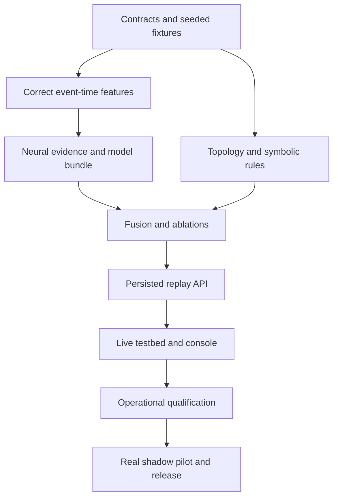

# DCE — Implementation plan

Date: 2026-10-02 | Companion specification: [PRD.md](PRD.md)

## 1. Delivery approach

Implement a vertical slice first: telemetry replay → distinct per-service windows → neural evidence → symbolic hypotheses → fusion → persisted incident with explanation. Advance to live attachment after that behavior is measurable. Preserve all notebooks and use them as reference inputs; place canonical behavior in a Python package with CLI/API/worker entry points.

This plan creates an explicit neuro-symbolic architecture. Neural outputs become symbolic facts with provenance. Graph and temporal constraints shape root ranking. Ablations must prove the learned evidence contributes. A temporal encoder is the initial model; adding graph message passing is an experiment requiring measurable benefit and export compatibility.

## 2. Proposed package and deployment structure

```text
src/dce/
  contracts/       # typed telemetry, graph, window, model, incident schemas
  config/          # validated configuration and version/hash
  ingestion/       # batch validation, adapters, identity and unit mapping
  features/        # resampling, counters, masks, windows, preprocessing
  neural/          # training-only code, scoring contracts, export
  inference/       # bundle validation and ONNX Runtime provider
  knowledge/       # graph snapshots, rule definitions and provenance
  reasoning/       # facts, hypotheses, timing, contradiction checks
  fusion/          # candidate ranking, uncertainty and abstention
  incidents/       # lifecycle, deduplication, evidence and feedback
  recommendations/# runbook selection, prerequisites and explanation
  persistence/     # database, queue leases, migrations and outbox
  api/             # routes, authorization and error contracts
  worker/          # event processing, checkpoints and restart recovery
  evaluation/      # event matching, metrics, ablations and reports
  simulation/      # seeded faults and generated ground truth
  cli.py
web/               # operator console
tests/{unit,contract,integration,replay,failure,performance}/
configs/           # examples with no credentials
deploy/{compose,kubernetes,collector}/
docs/{decisions,runbooks}/
```

Use a pyproject with runtime, training, adapter and development dependency groups. Resolve and lock tested versions during implementation. Online images exclude training dependencies. Start with FastAPI, ONNX Runtime, NetworkX and PostgreSQL; use shared interfaces so broker adoption does not require rewriting reasoning. No requirement to create an independent microservice for every package.

## 3. Architectural decisions to record

| ADR | Initial decision | Rationale and validation |
|---|---|---|
| 001 | A → B means A depends on B | Consistent root traversal and reverse impact tests |
| 002 | Metrics perception; traces topology evidence | Attach to observability; no packet capture requirement |
| 003 | Service-level model with instance evidence retained | Bound graph size while preserving instance diagnosis context |
| 004 | Shared per-service temporal encoder | Variable service membership without a fixed flattened eight-node head |
| 005 | Explicit evidence fusion and abstention | Inspectable hybrid contribution; calibrated confidence gate |
| 006 | PostgreSQL durable queue/outbox for pilot | Minimize infrastructure; measure leasing/load limits |
| 007 | At-least-once with idempotent decisions | Explicit crash/replay behavior |
| 008 | Immutable model, rule, graph and feature versions | Replay and atomic rollback |
| 009 | Recommendation-only recovery | Initial product scope |

Model graph upgrade: experiment with adjacency-aware embeddings only after the shared temporal baseline is established. If export cannot preserve operator behavior/parity, keep the baseline in production and retain the challenger as research.

## 4. Phase backlog and exit gates

Estimates assume two backend/platform engineers, one ML engineer and part-time SRE/security review. They are planning ranges, not commitments; model/data access can dominate the schedule. Work packages partly overlap. Approximately 16–24 engineering weeks to qualification plus a 30-day shadow pilot is a starting estimate, to revise after baseline.

### Phase 0 — contracts and reproducible baseline (1–2 weeks)

| Task | Deliverable | Acceptance |
|---|---|---|
| P0.1 | Notebook provenance inventory | Map each extracted behavior to source cell; record known defects |
| P0.2 | ADRs and contracts | Telemetry, graph, windows, evidence, incidents and model manifests validated |
| P0.3 | Package/config/CLI foundation | Fresh installation can run a small seeded replay; no Kaggle paths or runtime pip installs |
| P0.4 | Dataset manifest and baseline report | Seeds, data hashes, fault schedule, split policy and old-output caveats recorded |
| P0.5 | Fault simulator repair | Modify root and affected nodes, respect durations; distinct signatures; idempotent metric application |

Exit: reproducible small fixtures covering normal operation, database degradation, service crash, partition and concurrent faults. The simulator's true fault schedule is stored separately from inference inputs. Shared-resource failure and retry storms are later testbed cases. Establish realistic queue constraints; do not claim Gaussian smoothing is fractional Gaussian noise or uniform failure times are Weibull samples.

### Phase 1 — feature pipeline and neural evidence (2–3 weeks)

P1.1 builds event-time resampling with a configurable lateness allowance, counter resets, bounded fill, missingness masks and deterministic service mapping. P1.2 implements synchronized windows containing each service's actual observations. P1.3 replaces per-window-only normalization with train-fitted preprocessing plus explicit level/change features; compare alternatives on held-out data rather than assuming one is best. P1.4 defines detection and forecasting labels separately and uses chronological splits with embargo. P1.5 trains a shared temporal encoder with per-service evidence and a non-neural baseline. Correct loss weighting and threshold/checkpoint selection. P1.6 exports a model bundle with ONNX, feature contract, normalization, calibration, threshold, checksum, data manifest and evaluation report.

Exit: channel sentinel tests prove alignment; offline/online feature parity passes; no split leakage; fixed held-out test is untouched during tuning; ONNX outputs meet declared absolute/relative tolerances across normal, fault, missing and boundary-shape fixtures. Threshold/calibration belong to the selected checkpoint, not the last epoch. Record poor performance and stop promotion if gates fail.

### Phase 2 — knowledge, reasoning and fusion (2–3 weeks)

P2.1 persists immutable graph snapshots with validity and edge provenance. P2.2 turns model/SLO observations into timestamped facts. P2.3 implements dependency traversal, onset intervals, contradiction tests, root-set hypotheses, cyclic graph handling and observed/potential impact. P2.4 implements a transparent scoring policy and abstention rules. P2.5 serializes evidence graphs and runbook recommendations. P2.6 runs threshold-only, neural-only, symbolic-only and hybrid comparisons with the same event matcher and alert budget.

Exit: user-db as dependency of auth/api yields correct reverse impact; fabricated timestamps are absent; normal/ambiguous/concurrent cases do not force roots; both evidence branches affect outcomes. Produce a hybrid contribution report. If fusion adds no measurable value, iterate here before calling the release a validated neuro-symbolic system.

### Phase 3 — deployable replay service (2 weeks)

P3.1 adds migrations for environments, telemetry acceptance, topology versions, bundle activation, work leases, decisions, incidents, evidence, feedback and notification outbox. P3.2 adds CLI replay and API contracts. P3.3 implements worker recovery with lease renewal and bounded windows. P3.4 creates Docker images and Compose setup. P3.5 adds request IDs, health, metrics and structured logs.

Exit: from a clean Linux container environment, submit telemetry, receive acceptance ID, await diagnosis and retrieve evidence. Restart workers at acceptance, before commit and after commit; no acknowledged input loss or duplicate incident/notification intent. PostgreSQL queue leasing must be proven under concurrent workers before adding replicas.

### Phase 4 — live attachment and operator workflow (2–3 weeks)

P4.1 defines Collector mapping and integration fixture. A stock OTLP exporter cannot simply target a custom JSON endpoint: implement an OTLP receiver or configure an explicit tested translation path. Preserve histogram/counter semantics. P4.2 connects an instrumented microservice testbed. P4.3 adds authenticated incident/topology/model APIs and minimal console screens. P4.4 adds signed webhooks with retries and delivery records. P4.5 adds feedback and runbook prerequisites. P4.6 writes install, onboarding, troubleshooting and replay runbooks.

Exit: a live testbed fault creates an incident with real metrics and trace-derived or operator-provided topology; console reveals candidates, evidence, missing data and version identity. Notifications and feedback work end to end. No manual tensor editing is needed to demonstrate detection.

### Phase 5 — production operation (3–4 weeks)

P5.1 adds Prometheus adapter and qualified broker ingestion when load/reliability requirements warrant it. P5.2 implements partition ownership, checkpoint/replay and backpressure. P5.3 adds Kubernetes manifests/Helm packaging, secrets, resource limits and readiness. P5.4 implements OIDC/RBAC and object-level environment checks. P5.5 qualifies backups, restores and migrations. P5.6 adds atomic model promotion, warm loading, readiness validation, shadow comparison and rollback. P5.7 hardens notification destination handling, cardinality/payload limits and retention.

Exit: PRD operational targets measured under declared load; failure and recovery drills pass; access and isolation checks pass; deployment can be upgraded and rolled back with documented state compatibility. Do not autoscale workers without coherent ownership of environment/window state.

### Phase 6 — research and production qualification (2–3 weeks plus pilot)

P6.1 runs at least 100 controlled faults across categories/workloads and seven fault-free days. P6.2 publishes incident metrics and paired ablations with uncertainty intervals. P6.3 qualifies calibration and abstention coverage. P6.4 runs load/soak and failure tests on declared hardware. P6.5 conducts a 30-day real-environment shadow pilot with operator review. P6.6 resolves qualification findings and records release evidence and support ownership.

Exit: every production gate has a report or an explicitly approved revised target. Deployment success cannot substitute for accuracy or pilot evidence. If real telemetry is unavailable, release as a deployable research demonstrator with that limitation documented.

## 5. Critical path and first implementation slice



First two weeks: package/contracts/config, small repaired simulator, immutable graph semantics, deterministic aligned window fixtures, simple neural score interface, rule evaluation interface and replay output. A temporary deterministic neural test double is permitted only in automated integration fixtures and must be labeled; the demo/qualification path requires a trained model.

First vertical-slice acceptance command set (interfaces to implement):

```text
dce simulate --config configs/testbed.yaml --output <dataset-directory>
dce train --dataset <dataset-directory> --output <bundle-directory>
dce evaluate --dataset <held-out-directory> --bundle <bundle-directory>
dce replay --dataset <dataset-directory> --bundle <bundle-directory> --output <report-directory>
docker compose -f deploy/compose/compose.yaml up --build
```

These are planned interfaces; they do not exist in the current repository.

## 6. Runtime algorithm and state consistency

1. Authenticate and validate batch; canonicalize identity/units; persist acceptance and queue work transactionally.
2. Deduplicate events; aggregate by event time and service; handle lateness according to configured watermarks. Events beyond lateness enter replay/dead-letter handling, with explicit reason.
3. Build windows for the complete registered service scope; preserve raw values and generate model features/masks. Record the immutable topology snapshot. Do not confuse missing services with healthy values.
4. Invoke the bundle's neural provider with deadline and compatibility checks; extract per-service scores/onset intervals.
5. Evaluate symbolic facts over raw observations and neural evidence; build supported and contradicted candidate root sets.
6. Fuse scores, enforce structural constraints and abstain if support/quality is insufficient. Record processing mode.
7. Correlate/deduplicate incident using scope, overlapping event interval and root-set similarity; keep decision revisions.
8. Commit decision, evidence, incident revision and notification outbox atomically, then acknowledge work.
9. Deliver notifications asynchronously; collect feedback separately; retrain/promote only through evaluation workflow.

Replay pins all versions and configuration. A live promotion occurs at a window boundary and records the activated bundle for subsequent decisions. Graph updates also take effect at declared boundaries; do not combine edges from multiple revisions in one explanation.

## 7. Verification matrix

| Area | Required cases | Evidence artifact |
|---|---|---|
| Features | Distinct channel sentinels, unit conversion, counter reset, out-of-order/late events, missing samples, joins/leaves | Feature parity and alignment report |
| Neural | Valid/invalid bundle, capacity boundaries, real inference, calibrated/uncalibrated status, ONNX parity | Bundle validation and model card |
| Reasoning | DB propagation, root with normal metrics but dependent symptoms, cycles, shared dependency, two roots, contradictions | Golden evidence graphs |
| Fusion | Branch disagreement, neural shuffle, topology removal, timing removal, symbolic-only degradation | Ablation report |
| Evaluation | One-to-one matching, duplicate incidents, unmatched predictions, cold start, held-out seeds/topologies | Reproducible benchmark report |
| Runtime | Kill/restart around commits, expired lease, duplicate batch, unavailable database, full queue, stale model | Recovery and durability report |
| Integrations | Actual Collector path, Prometheus reset semantics, webhook retry/failure, operator feedback | End-to-end testbed report |
| Security | Authentication, role/object access, oversize data, secret redaction, rejected artifacts/destinations | Access/threat review |
| Operations | Reference load, soak, lag, resource footprint, backup restore, rollout rollback | Qualification report/runbooks |

Unit tests enforce semantics; integration tests verify boundaries; replay tests verify the whole inference path. Avoid relying on notebook printed success messages. CI runs formatting/static checks and small deterministic suites; scheduled qualification runs execute expensive training/testbed/load checks. Dependency and container scans gate releases according to documented policy.

## 8. Traceability and ownership

| PRD requirements | Work packages | Primary owner |
|---|---|---|
| ING-01/02/04, FEA-01/02 | P0.2, P1.1–3, P3.1–3, P4.1 | Backend + ML |
| ING-03, TOP-02 | P4.2, P5.1 | Platform |
| TOP-01, SYM-01 | P2.1–3 | Reasoning/backend |
| NEU-01, MOD-01 | P1.4–6, P5.6 | ML |
| FUS-01/02 | P2.4/6, P6.2/3 | ML + reasoning |
| INC-01/02, OPS-01 | P2.5, P3.1–3, P5.2 | Backend |
| API-01, UX-01, FB-01 | P3.2, P4.3/5 | Backend + frontend |
| NOT-01, REC-01 | P2.5, P4.4/5 | Backend + SRE |
| SEC-01 and reliability targets | P5.3–7, P6.4–6 | Platform + security + SRE |

Actual people must be assigned at kickoff; research accuracy and operational release each need an accountable owner.

## 9. Milestones and release evidence

M0: reproducible simulator and contracts. M1: offline neuro-symbolic replay with genuine neural invocation and ablation report. M2: containerized persistent API. M3: real testbed connection and operator console. M4: recovery/security/load qualification. M5: completed shadow pilot and release decision.

Release artifact set: versioned source/image, deployment templates, model bundle/model card, rule/topology schemas, dataset manifests, benchmark and ablation reports, API specification, evidence examples, threat/access review, install/upgrade/rollback/restore runbooks, operational dashboard definitions, known limitations and support ownership.

Research hypotheses: hybrid evidence improves root ranking at the same alert budget; temporal constraints reduce symptom-as-root errors; abstention improves retained-decision accuracy. Pre-register evaluation choices before opening held-out results. Failure to support a hypothesis is a valid research result and blocks unsupported product claims.
