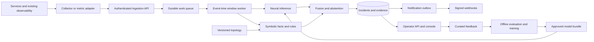

# Distributed Causal Engine — Product Requirements Document

Version: 1.0 draft | Date: 2026-10-02 | Status: implementation specification

## 1. Product definition

DCE is an attachable neuro-symbolic incident intelligence system for distributed services. It learns abnormal temporal behavior from telemetry, combines that evidence with explicit service dependencies and temporal rules, ranks possible incident origins, and presents an inspectable explanation with recovery recommendations.

The initial product runs in a customer's environment and connects to existing observability infrastructure. It serves SREs, platform engineers, and developers investigating cascading failures. Its primary output is an evidence-backed incident hypothesis, including uncertainty; it does not assert that observational evidence proves causation.

The research contribution is a testable integration of neural perception and symbolic reasoning. Production engineering makes that integration reproducible, observable, deployable, and useful on real telemetry.

## 2. Problem and objective

Distributed failures generate symptoms across multiple services. Threshold alerts identify individual breaches but leave operators to reconstruct which symptoms share an origin, how dependencies explain propagation, and what action is justified. Neural anomaly models can recognize patterns but may lack structural explanations. Rules provide structure but are brittle under changing workloads.

DCE must combine learned temporal evidence with explicit domain knowledge to reduce investigation effort without hiding ambiguity. Success means better incident detection and root ranking than either component alone, plus a reproducible explanation operators can verify.

## 3. Current state and migration constraints

The repository currently consists of five research notebooks, a README, and an incomplete runtime dependency list. The pasted productionization brief is the starting direction. Live inspection of DCE_Final.ipynb confirms replicated single-node tensors via np.tile, random overlapping-window splits, fixed eight-node assumptions, Kaggle paths, a pipeline constructor keyword mismatch, no ONNX inference in ingest_window, and descendant-based blast-radius logic despite caller-to-dependency edges.

Earlier notebook evaluation in this conversation reported weak F1 and inconsistent streaming detections. Those historic outputs are research evidence, not production benchmarks. Establish new reproducible baselines before making performance claims. Preserve notebooks as provenance; extracted package code becomes the canonical implementation. The untracked scrap directory is outside this product.

## 4. Users and workflows

| User | Need | Workflow and expected result |
|---|---|---|
| Platform engineer | Attach DCE without replacing observability | Configure adapter, verify mapping and topology, observe ingestion health |
| On-call SRE | Identify plausible incident origin | Open incident, inspect ranked candidates, temporal evidence, paths and uncertainty |
| Service owner | Verify and correct diagnosis | Review evidence, mark hypothesis correct/incorrect/unknown, record resolution |
| ML engineer | Reproduce and promote models | Replay versioned data, compare baselines, export bundle, approve promotion |
| Administrator | Operate securely | Manage access, retention, deployment, backups and audit records |

Core journey: connect environment → validate signals → register topology → establish baseline → run in shadow mode → inspect incidents → submit feedback → evaluate changes → promote a version.

## 5. Release scope

### R0: executable research foundation

CLI simulator, dataset manifests, offline replay, correct synchronized tensors, temporal baseline, symbolic engine, fusion, evidence output, and repeatable evaluation. No notebook state required.

### R1: deployable pilot

Single-environment installation; authenticated JSON ingestion and a documented OpenTelemetry Collector integration; asynchronous worker; PostgreSQL persistence; versioned topology and model bundles; incident APIs; minimal operator console; webhook delivery; Docker Compose; recommendation-only recovery; operational runbooks.

### R2: production qualification

Prometheus adapter, broker-backed ingestion, worker recovery and replay, Kubernetes deployment, OIDC/RBAC, backup/restore qualification, model rollout/rollback, realistic fault experiments, sustained pilot validation, and load/failure testing. Production designation is gated by evidence, not packaging.

### Deferred scope

Automatic infrastructure remediation, hosted multi-tenant SaaS, unconstrained causal discovery, arbitrary metric schemas without mapping, LLM-generated causal conclusions, every observability vendor, and GPU training inside online workers. A graph neural model is a later experiment if it demonstrably improves the temporal baseline.

## 6. Neuro-symbolic contract

### Neural perception

Input is a synchronized event-time window with distinct service signals, feature units, missingness masks, and a declared schema. The initial model shares a temporal encoder across services and emits per-service anomaly scores and onset evidence. Detection and forecasting are separate tasks and labels. A forecast label must refer strictly to events after the observation window; an overlapping failure label is detection.

Train-only preprocessing statistics travel with the model. Keep raw metrics for rules. Prefer a score called anomaly_score unless probability calibration has been measured on held-out data. A model must not silently accept an incompatible feature order, units, or node capacity.

### Symbolic knowledge

Maintain a versioned graph where A → B means A depends on B. To investigate a symptom at A, traverse its dependencies toward B; to estimate services potentially impacted by B, traverse reverse dependencies. Distinguish observed impact from topology-only potential impact. Cycles are allowed and handled with visited sets or strongly connected components.

Represent facts such as anomalous(service, interval, evidence), depends_on(caller, callee, validity), degradation_onset(service, time, uncertainty), and slo_breach(service, metric, value, threshold). Every derived fact carries provenance and rule version.

Rules test valid dependency paths, cause-before-effect timing, compatible fault signatures, contradictory healthy observations, missing data, and shared upstream infrastructure. Use observed onset intervals; never manufacture cause timestamps as current_time minus a constant. Thresholds and propagation bounds are configuration, not universal constants.

### Fusion and abstention

Candidate generation takes the union of neural detections and explicit SLO breaches. Hard constraints reject unsupported service identities, stale/incompatible topology, and impossible temporal claims. Soft evidence ranks remaining root sets using learned anomaly evidence, dependency support, timing, explanatory coverage, contradiction penalties, and data quality. Initial ranking is transparent and configurable; later weights may be fitted only on training/calibration data.

The incident trigger and root rank must depend on both branches when both are available. Record each branch's contribution. A high neural score without structural support may open an anomaly incident but must not produce a confident causal claim. A strong SLO breach during model failure may produce a symbolic_only incident with explicit degraded status. Missing evidence can yield unknown or multiple candidates. Confidence is a calibrated correctness estimate only after evaluation; otherwise return ranking_score and confidence_status=uncalibrated.

Feedback is curated offline. It must not rewrite production rules or retrain an active model automatically. Joint differentiable reasoning is optional research beyond the initial explicit evidence-fusion design.

## 7. Functional requirements

| ID | Priority | Requirement | Acceptance criterion |
|---|---|---|---|
| ING-01 | P0 | Accept authenticated bounded telemetry batches | Validate schema, units, identities and limits; acknowledge only durable acceptance; deterministic duplicate handling |
| ING-02 | P0 | Map real observability signals | Collector integration fixture maps service identity, latency, errors, traffic and resource metrics; unavailable metrics remain missing |
| ING-03 | P1 | Support Prometheus ingestion | Preserve timestamps and counter semantics; integration fixture handles reset and duplicate samples |
| ING-04 | P0 | Handle bad and late data | Invalid records produce reason codes; late records follow explicit watermark policy; backlog is observable |
| TOP-01 | P0 | Version service dependencies | Validate identities and edge semantics; attach one immutable topology version per decision |
| TOP-02 | P1 | Propose dependencies from traces | Proposed edges include observation source and validity; operator review or configured adoption policy is visible |
| FEA-01 | P0 | Assemble synchronized windows | No channel duplication; timestamps aligned; missingness represented; offline and online transformations match |
| FEA-02 | P0 | Track preprocessing contracts | Bundle includes schema, units, statistics and limits; mismatch rejects inference or explicitly degrades |
| NEU-01 | P0 | Execute versioned neural inference | Actual model invocation returns per-service evidence; incompatible bundles fail readiness; deadlines are enforced |
| SYM-01 | P0 | Evaluate dependency and timing rules | Positive, negative, cyclic, ambiguous and missing-data fixtures produce expected hypotheses and evidence |
| FUS-01 | P0 | Combine both evidence branches | Controlled changes to neural and symbolic inputs affect decisions; ablations quantify each contribution |
| FUS-02 | P0 | Support uncertain/multiple origins | Unknown, contradictory and concurrent faults do not force a single root |
| INC-01 | P0 | Manage incident lifecycle | open → investigating → resolved or dismissed; deduplicate symptoms and record revision history |
| INC-02 | P0 | Persist reproducible decisions | Evidence, input references, model, rule, topology, feature and configuration versions are retained |
| API-01 | P0 | Expose operator APIs | Versioned OpenAPI, pagination, error envelope, idempotency, role checks and integration tests |
| UX-01 | P0 | Provide operator console | Connection health, incident list, ranked candidates, evidence timeline, observed/potential impact and feedback |
| NOT-01 | P0 | Deliver webhook notifications | Signed payloads, retry limits, delivery audit and destination failure isolation |
| REC-01 | P0 | Recommend recovery actions | Runbook IDs, preconditions, expected checks, risk and rollback reference; no execution in R1/R2 |
| FB-01 | P0 | Collect operator feedback | Append-only labels with author, time and incident revision; curated export for evaluation |
| MOD-01 | P0 | Promote and roll back bundles | Checksum, compatibility and evaluation gate; atomic activation; previous bundle retained |
| OPS-01 | P0 | Support deterministic replay | Same input and pinned versions reproduce decision IDs/evidence within documented numerical tolerance |
| SEC-01 | P0 | Authenticate and audit access | No unauthenticated mutation; secrets excluded from logs; authorization checks cover every object |

## 8. Data and API specification

Telemetry envelope: schema_version, event_id, environment_id, service_id, instance_id, observed_at, received_at, source, metrics, quality flags, trace references. Each metric includes canonical name, value, unit and kind. Ingestion batches include batch_id. Treat event time and processing time separately; derive rates from counters with reset handling; aggregate histogram latency correctly rather than averaging percentiles.

Window envelope: window_id, environment_id, start/end, interval, ordered service IDs, feature schema version, raw values, normalized values, masks, topology version and quality summary. Default research configuration may use 10 samples and a five-sample stride, but pilot settings must reflect the source cadence. Model manifests declare supported context length and service capacity. Service joins/leaves trigger an explicit mapping revision; excess capacity cannot be silently truncated.

Incident record: incident_id, revision, environment_id, event interval, detected_at, status, processing_mode, anomaly evidence, ranked root sets, abstention reason, observed/potential impact, evidence graph, recommended runbooks, version references and feedback. Each candidate names supporting and contradicting evidence IDs. No ground-truth event is consulted during inference.

Initial endpoints:

| Method/path | Purpose |
|---|---|
| POST /v1/telemetry/batches | Durable telemetry acceptance; returns batch ID and status |
| GET /v1/telemetry/batches/{id} | Processing/rejection status |
| POST /v1/topologies | Publish immutable validated graph version |
| GET /v1/topologies/{id} | Read graph and provenance |
| GET /v1/incidents | Filtered, paginated incident list |
| GET /v1/incidents/{id} | Candidates, explanations and evidence |
| POST /v1/incidents/{id}/feedback | Record diagnosis/resolution feedback |
| POST /v1/incidents/{id}/transitions | Authorized lifecycle transition |
| GET /v1/models | Bundle metadata and activation status |
| POST /v1/models/{id}/activation | Administrative promotion with audit |
| GET /health/live; GET /health/ready | Process health and dependency/model readiness |

Use UTC timestamps, explicit units, cursor pagination and request IDs. Duplicate writes return the existing result. Unauthorized cross-environment references must fail. Batch acceptance does not imply diagnosis completed.

## 9. Runtime architecture

Logical components may share a process initially. Separate ingestion/API and worker entry points; split further only when throughput or isolation requires it.

Pilot: Python package, API and worker containers, PostgreSQL work queue/incident store, Collector and static operator console. Worker queue leasing and transactional outbox avoid dual-write loss. Store replay datasets and model artifacts on local volumes in development and object storage in production. PostgreSQL is not a replacement for the customer's long-term metrics backend.

Production scaling: broker-backed queue, keyed by environment and topology scope; bounded worker state; replay/checkpoints; PostgreSQL metadata/evidence store; object storage archives; Kubernetes deployment. Keep state ownership stable across partitions. A single environment's graph analysis must receive a coherent window rather than independently partitioning each node and losing synchronization.

## 10. Reliability, security and operation

Durable acceptance and at-least-once processing require event/decision deduplication. Processing must atomically persist decisions and notification-outbox entries before marking work complete. Restart recovery reconstructs windows from retained input/checkpoints. Queue depth and age trigger backpressure; unbounded buffers are prohibited. Retention must exceed the configured recovery/replay interval.

Model failure selects a documented symbolic_only mode or abstention. Topology uncertainty reduces claim strength. Stale telemetry closes readiness for affected analysis scopes, not necessarily process liveness. Notifications must not block inference. Configuration changes and promotion operations are audited.

Pilot supports API credentials with scoped roles; production uses organization OIDC plus RBAC. Encrypt transport, use secret injection, bound payload/cardinality, redact sensitive attributes, restrict webhook egress, and isolate environments in every storage/API query. Store telemetry aggregates, not packet payloads. Threat review includes poisoned feedback, forged topology, malicious model artifacts, and webhook destinations. Only trusted, checksum-verified model bundles are loaded.

Initial configurable retention proposal: accepted telemetry/replay inputs 7 days, incident evidence and audit 90 days, promoted model bundles while referenced. Validate customer needs and storage budget before pilot. Provide deletion/backup lifecycle documentation.

## 11. Evaluation and release targets

All numbers below are proposed qualification targets, not observed performance guarantees. Ratify them after R0 baseline and workload sizing; document any revision before release evaluation.

Reference load: one environment, 100 services, four instances each, ten scalar measurements per instance each second: 4,000 scalar measurements/s, typically batched into 400 instance events/s. A one-second grid, 30-second context and five-second stride are an initial load profile, not a universal modeling configuration. Reference deployment budget: aggregate 8 vCPU and 16 GiB memory for API/worker/database on declared benchmark hardware; CPU inference, no online training. Publish exact placement and resource usage.

| Dimension | Proposed production gate | Measurement |
|---|---|---|
| Event detection | Precision ≥0.85 and recall ≥0.80 | Held-out labeled incidents, one-to-one matching, fixed threshold |
| Root ranking | Top-1 ≥0.75; Top-3 ≥0.90 | Report correct root sets, coverage and accuracy conditional on non-abstention |
| False alerts | ≤1 per environment-day | Separate fault-free workload periods; publish service-hours |
| Hybrid contribution | ≥5 percentage-point Top-1 improvement over stronger ablation | Paired incidents, uncertainty intervals, comparable alert budgets |
| Confidence | ECE ≤0.10 when probability confidence is exposed | Held-out calibration bins and coverage/risk curve |
| Processing latency | p95 ≤2s; p99 ≤5s after window eligibility | Includes queue, inference, reasoning and commit under reference load |
| Detection delay | Median ≤30s and p95 ≤60s after first observable symptom | Report warm/cold start, collection cadence and injected-onset delay separately |
| Availability | 99.5% monthly pilot; 99.9% production objective | Eligible incident processing/API requests with documented exclusions |
| Durability | No acknowledged input lost in tested single-process failures | Kill/restart replay and duplicate delivery tests |
| Recovery | RPO ≤5min; RTO ≤30min | Documented backup/restore drill; distinct from normal worker restart |
| Integration overhead | Collector/adapter overhead within agreed budget | Measure against application without DCE; no assumed percentage |

Evaluation uses chronological splits with an embargo at least context plus forecast horizon, separate simulation seeds/topologies and a held-out testbed workload. Do not leak fault schedules, labels or resolution metadata into inputs. Match detected events to true events by environment, bounded interval and explicit root criteria; unmatched detections are false positives, unmatched true events false negatives. Count repeats separately and then show deduplicated incident metrics. False positives cannot count as zero-latency successes. Publish multi-fault, no-fault, missing-data and topology-change results.

Required comparisons: threshold-only, neural-only, symbolic-only, hybrid; topology removed, timing removed, neural scores shuffled, missingness stress. Keep tuning on train/calibration only. Include incident-level confidence intervals and report insufficient sample sizes honestly. Pilot qualification requires at least 100 controlled faults across supported categories and multiple workload levels plus seven fault-free days, followed by a 30-day real-environment shadow pilot with operator-reviewed findings. Synthetic qualification alone does not establish real-world accuracy.

## 12. Operator experience and evidence

Console screens: setup/connection health; topology version and edge provenance; incident queue; incident detail with candidate ranking and uncertainty; evidence timeline and dependency paths; recommendations and feedback; administrative version status. Show stale/missing data, disabled model, unsupported schema and symbolic-only mode prominently. Do not label uncalibrated scores as percentages of certainty.

Every explanation must cite recorded observations/rule evaluations. Operator feedback distinguishes correct, incorrect, uncertain and insufficient evidence. An LLM narrative layer may be added later, but the evidence graph remains the authoritative output.

## 13. Dependencies, risks and open decisions

Dependencies: an instrumented testbed, incident labels, telemetry access, stable service identities, topology source, maintained deployment environment, and SRE review capacity. Without real pilot access, delivery can reach a deployable demonstrator but cannot pass production qualification.

| Risk | Response |
|---|---|
| No learnable pre-failure signal | Ship detection first; forecasting remains separately gated |
| Hybrid fails to improve over rules | Retain stronger baseline; revise evidence fusion/model before research claims |
| Incomplete or changing topology | Version validity, expose uncertainty, abstain on unsupported paths |
| Domain drift | Monitor feature/score drift; evaluate challenger offline; rollback bundles |
| Concurrency/shared infrastructure confounds | Root-set hypotheses and infrastructure nodes; bounded uncertainty |
| Excess operational complexity | Two runtime entry points initially; scale queue only with evidence |

Defaults: self-hosted Linux containers; single-environment pilot; metrics-first perception with traces supplying topology; recommendations only; CPU inference; manual model promotion. Decisions to ratify before live pilot: environment/provider, source metric mappings, identity granularity, required fault types, retention budget, resource budget, operator workflow, and ownership of deployment/secrets. These do not block R0/R1 development.

## 14. Definition of done

R1 is done when a fresh container installation ingests real testbed telemetry, builds correct windows, invokes an approved model, executes symbolic rules, combines both branches, persists inspectable incidents, supports operator review and replay, and passes the integration suite without notebook execution.

Production qualification additionally requires measured accuracy and operational gates, security/access checks, restart and restore drills, rollout/rollback runbooks, completed shadow pilot, support ownership, and documented known failure modes. Deployability, research validity and production readiness are separate release evidence.
