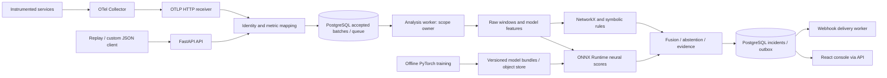

# DCE technology stack and integration decisions

Date: 2026-10-02 | Status: proposed implementation choices, not installed or benchmarked

Companion documents: [PRD](PRD.md) and [implementation plan](IMPLEMENTATION_PLAN.md).

## 1. Recommended stack

Build one Python domain package with separate API and analysis-worker processes, plus a TypeScript operator console. Use PostgreSQL as the pilot's durable work queue and application database. Keep training offline in PyTorch and use ONNX Runtime for online scoring. Store versioned dependencies in PostgreSQL and evaluate them in NetworkX with explicit Python rules. Make evidence fusion a first-class module.

Attach through OpenTelemetry Collector and a real OTLP/HTTP receiver implemented in the ingestion service. Support JSON batches for replay and custom integrations. Add Prometheus scraping through Collector configuration when needed. Introduce Kafka for the production scale profile after ownership, replay and delivery contracts are established; packaging Kafka does not establish high availability.

The choices below prioritize reproducibility, explicit neuro-symbolic behavior, and manageable operation. Exact dependency versions must be selected together and locked after compatibility testing. No claim here depends on an untested latest release.

| Layer | Selected technology | Stage |
|---|---|---|
| Backend language/tooling | Python 3.12 target, uv, pyproject.toml | Foundation; compatibility gate before locking |
| API and contracts | FastAPI, Uvicorn, Pydantic v2, pydantic-settings | Pilot |
| Telemetry | OpenTelemetry Collector Contrib; OTLP/HTTP protobuf ingestion using generated OTLP messages | Pilot |
| Features | NumPy, PyArrow/Parquet; pandas for offline exploration | Foundation |
| Training | PyTorch, scikit-learn evaluation/calibration utilities | Offline foundation |
| Serving | ONNX, ONNX Script export dependency, ONNX Runtime CPU | Pilot |
| Symbolic reasoning | NetworkX + typed facts + explicit tested Python rules | Foundation |
| Fusion | DCE-owned transparent ranking and abstention module | Foundation |
| Persistence | PostgreSQL, SQLAlchemy 2, psycopg 3, Alembic | Pilot |
| Work scheduling | PostgreSQL queue/leases + dedicated worker; transactional outbox | Pilot |
| Scale transport | Apache Kafka + confluent-kafka Python client | Production scale profile |
| Artifacts/replay | Parquet + immutable manifest bundles; filesystem locally, S3-compatible object storage in production | Foundation → production |
| Frontend | React, TypeScript, Vite, TanStack Query, React Router | Pilot |
| Graph/chart UI | Cytoscape.js, Apache ECharts | Pilot, bounded graph views |
| Edge/web hosting | Nginx for static console, API proxy and TLS integration | Pilot |
| Identity | Scoped API keys for machine ingestion; organization OIDC with Authlib for console, PostgreSQL-backed sessions | Pilot keys → production OIDC |
| Application observability | prometheus-client, OpenTelemetry SDK, structured JSON logging; Prometheus/Grafana | Pilot |
| Tests/tool quality | pytest, Hypothesis, Ruff, mypy, Playwright, k6 | Foundation → qualification |
| Delivery | GitHub Actions, Docker/Compose; Helm/Kubernetes for production profile | Pilot → production |

## 2. Runtime and responsibility boundaries

Initial containers: edge/console, API, analysis worker, notification worker, PostgreSQL and Collector. Prometheus/Grafana can be an optional operations profile. The notification process can share the worker image but must not block analysis. Online inference runs within the analysis worker initially, avoiding an extra network hop and inference service lifecycle.

Keep interfaces for TelemetryAdapter, WindowBuilder, NeuralProvider, KnowledgeStore, Reasoner, FusionPolicy, WorkQueue and ArtifactStore. Each interface carries typed/versioned envelopes. The API owns transport/authentication; the worker owns event-time state and diagnosis. Domain modules must not import FastAPI, broker clients or UI code.

## 3. Backend and contract reasoning

Python preserves the existing research ecosystem and supports training, arrays, graph traversal and serving in one language. This reduces translation errors when moving from notebooks. Tradeoff: CPU-heavy feature/reasoning work must run outside API handlers and be bounded; asynchronous HTTP does not make numerical computation faster.

FastAPI/Pydantic provide typed validation and an API schema for frontend/client generation. Use Pydantic for external envelopes and manifests, NumPy for numerical buffers; do not validate every scalar in a large tensor through Python objects. Use binary model inputs inside the worker and bounded batches at the API.

Run Uvicorn for APIs. Avoid loading a model in each API process: processes generally have independent memory, and replica count multiplies memory consumption. Keep model sessions in analysis workers and measure resource limits. [FastAPI deployment concepts](https://fastapi.tiangolo.com/deployment/concepts/).

uv provides the project environment and lockfile. Commit uv.lock, separate runtime/training/development groups, and use locked installs in CI/images. Lock frontend packages with npm's lockfile and npm ci. Pin container image digests for releases. Dependency upgrades pass the same parity/integration gates. [uv locking and syncing](https://docs.astral.sh/uv/concepts/projects/sync/).

Weak gap: schemas are only syntax unless they include units, metric kinds, service identity, observed time, processing time, quality flags and version references. Generate TypeScript API types from OpenAPI and fail CI on unexpected breaking contracts.

## 4. Telemetry attachment reasoning

Collector is the attachment layer because environments already expose OTLP or Prometheus signals. Configure receivers, resource attributes, batch and memory limits, and explicit export paths. Collector Contrib is selected for the needed receiver/processor range; qualify the exact distribution/configuration because components are not interchangeable across images.

Implement POST /v1/metrics and POST /v1/traces as OTLP/HTTP protobuf endpoints using generated protocol messages, separate from POST /v1/telemetry/batches. The former accepts protocol payloads and returns protocol-compatible responses; the latter accepts DCE JSON. Support a documented subset of metric kinds and compression, reject unsupported transport/features explicitly, and test exporter retries/partial-success behavior. OTLP defines transports, payload encoding and delivery responses. [OTLP specification](https://opentelemetry.io/docs/specs/otlp/).

Prometheus source onboarding can use the Collector Prometheus receiver → OTLP exporter → DCE receiver path. An existing Prometheus server is not automatically an OTLP push source; specify whether Collector scrapes application endpoints or a separate adapter queries the existing server. Avoid two collection paths double-counting the same samples.

Maintain mapping files from source measurements to DCE features. Production services may expose request duration, error rate, CPU/memory and request throughput but not packet counts or queue depth. Missing metrics remain masked. The training model must use the selected real feature schema; it cannot assume notebook columns will exist everywhere. Traces support proposed dependencies but sampling means absence of a trace is not proof of no dependency.

Preserve histogram buckets and counter temporality. Aggregate distributions before estimating percentiles; do not average per-instance p95 values. Counter reset handling, resource identity and units require fixtures. [OTel metrics data model](https://opentelemetry.io/docs/specs/otel/metrics/data-model/).

Early gate: a genuine Collector exporter submits measurements to DCE, acknowledgments occur only after durable storage, malformed/unsupported payloads are visible, and generated features match expected values.

## 5. Feature and neural stack reasoning

NumPy is the online representation for fixed-size bounded arrays. PyArrow/Parquet is the offline/replay format because datasets need explicit schema and efficient column storage. pandas remains useful in research but online window assembly should avoid row-by-row DataFrame iteration. Start with one shared feature implementation for training/replay/live paths.

Maintain both raw physical observations and model features. Use event-time resampling, masks, reset-safe rates and train-fitted transformations. The shared temporal encoder consumes distinct service windows, with optional masks/change features, and emits service-specific anomaly evidence. It removes the current dependence on a flattened fixed eight-node head. A topology-aware neural challenger can be evaluated later against this baseline.

PyTorch is the training tool; scikit-learn supplies evaluation and calibration utilities. Detection and forecasting have different labels. Time splits, embargoes, held-out topologies and incident-level evaluation are application requirements, not features a library gives automatically. A GPU is optional offline; production scoring starts on CPU.

ONNX Runtime gives the online worker a model-serving contract separate from training code. Export dependencies belong to the training image. Model bundles include weights/ONNX, preprocessing, input/output schema, thresholds, calibration, limits, checksums and evaluation provenance. Warm and verify a new session before activating it at a window boundary.

Weak gaps: dynamic shape export, missing-mask compatibility, unsupported operators, output calibration and preprocessing mismatch. Test exported models on representative data and boundary shapes. Fix per-session thread budgets: multiple sessions/processes can compete for the same CPU. [ONNX Runtime thread management](https://onnxruntime.ai/docs/performance/tune-performance/threading.html).

Early gate: correct neural invocation, held-out baseline report, PyTorch/ONNX parity, variable service membership test, identical offline/online transformations, and no probability label without calibration evidence.

## 6. Symbolic and fusion reasoning

NetworkX evaluates dependency graphs in memory. PostgreSQL persists immutable node/edge snapshots; it is the source of truth. NetworkX is not a persistent knowledge database or a rule engine. A typed Python rule evaluator explicitly creates/rejects hypotheses and records evidence/provenance. Keep declarative threshold/runbook parameters in validated configuration; do not execute uploaded Python or arbitrary YAML expressions.

The initial scale is tens to hundreds of services, where graph algorithms are a straightforward fit. A separate graph database introduces operations and query boundaries without fixing incorrect edge semantics. Reconsider it only if measured graph size or persistent cross-environment query requirements justify it.

A → B means A depends on B. Search dependencies for origins and reverse dependencies for possible impact. NetworkX ancestors identifies nodes that can reach a target; this matches potential callers impacted by a failed dependency under this edge convention. [NetworkX ancestors](https://networkx.org/documentation/stable/reference/algorithms/generated/networkx.algorithms.dag.ancestors.html).

Fusion is DCE-owned code, not an off-the-shelf framework checkbox. Candidate scoring combines neural anomaly/onset evidence, graph validity, observed propagation, explanatory coverage, contradictions and quality. Hard constraints and abstention are explicit. Return candidate root sets, contribution scores, supporting/contradicting evidence and uncertainty.

DoWhy is an optional offline causal-estimation experiment if intervention assumptions/data support it, not a runtime requirement. An LLM/vector database does not solve these graph/time semantics. Defer a Datalog/probabilistic logic engine until rule complexity calls for it; typed facts and reproducible inference remain mandatory regardless of engine.

Early gate: remove/shuffle neural evidence and show measurable impact; remove topology/timing and show measurable impact; verify cycles, shared dependencies, healthy contradictions and multiple faults. Both branches must change outcomes under controlled fixtures.

## 7. Persistence, scheduling and scale reasoning

PostgreSQL stores environments, service identities, topology/rule/bundle versions, ingestion batches, work leases, incident revisions, evidence, feedback, sessions and notification outbox. Use relational keys for identity/lifecycle and JSONB for versioned variable evidence. SQLAlchemy/psycopg handle persistence; Alembic makes schema changes reviewable. Store large arrays/replay archives in Parquet/object storage and reference their manifests.

Pilot queue: accept batch + work row in one transaction. Claim queue rows in short transactions using FOR UPDATE SKIP LOCKED and persist a lease. Do analysis outside the transaction; enforce lease ownership and fencing on result commit. Commit result and notification intent before marking work complete. PostgreSQL documents SKIP LOCKED as useful for queue-like tables, not general consistent reads. [PostgreSQL SELECT locking](https://www.postgresql.org/docs/current/sql-select.html).

Critical distinction: queue-row leases prevent duplicate job ownership, but do not by themselves provide exclusive ownership of an environment's evolving window state. Add scope leases with fencing epochs, or run a single analysis owner for the pilot. Each scope has a deterministic sequence/checkpoint. Reclaim only with replay of retained inputs. Never let two workers mutate the same window independently.

Do not use FastAPI background tasks for acknowledged durable ingestion. Do not assume Celery/Redis solves graph-window ownership. A custom worker loop has engineering cost—leases, retries, checkpoints and failure tests—but keeps event-time behavior explicit.

Production scale: Apache Kafka selected as the durable transport; choose deployment sizing/provider after benchmarks. Use confluent-kafka client, explicit producer durability configuration, lag monitoring and idempotent event/decision IDs. Partition by environment plus coherent analysis scope. Consumer rebalance restores state/checkpoints and prevents stale owners committing results. A single large scope is still a throughput bottleneck; splitting it requires a justified graph boundary and correlation plan.

Kafka transactions do not make a PostgreSQL write atomically commit with an offset. Use database idempotency plus commit ordering: persist decision/checkpoint, then commit offset; replay after a crash must return the existing decision. Avoid DB-and-broker dual writes: choose durable acceptance in one primary log, or publish via a transactional outbox and acknowledge that backlog in monitoring. [Kafka delivery semantics](https://kafka.apache.org/41/design/design/).

Pilot queue to Kafka migration gate: target workload has sustained backlog or recovery/throughput objectives require a broker; verify state rebuild, rebalance, duplicates and outbox behavior before switching. The production scale profile in the PRD remains planned; a smaller production footprint may keep PostgreSQL if it independently passes the same reliability/load gates.

Capacity gap: 400 instance events/s implies 34.56 million events/day, or 241.92 million over seven days. If serialized events average 1 KB, that is about 242 GB before database indexes/replication. Measure payload size; archive batches efficiently, limit hot retention and bound cardinality. The PRD's 8 vCPU/16 GiB reference budget excludes broker cluster and long-term storage until those are measured.

## 8. Frontend, authentication and notifications

React/TypeScript/Vite produces a static console hosted by Nginx. This fits an authenticated operator application without requiring server-rendered public pages. TanStack Query handles API cache/refetch; React Router handles views. Start with polling; adopt SSE for incident updates if measured UX needs it. [Vite build/deployment guide](https://vite.dev/guide/).

Cytoscape.js displays topology/evidence paths; ECharts displays timelines and metric evidence. Request bounded subgraphs and downsample display series while preserving raw evidence references. Graph rendering is independent of backend graph reasoning. UI must distinguish observed/potential impact, calibrated confidence/ranking score, unknown roots and degraded inference modes.

Generate TypeScript clients from OpenAPI. Avoid duplicating formula/threshold logic in browser code. Test candidate interpretation, time zones, permissions and large incident graphs with Playwright.

Machine ingestion uses scoped API keys with hashed storage, rotation and audit. Console production auth uses organization OIDC, Authlib integration, server-side PostgreSQL sessions, HttpOnly cookies and CSRF controls for mutations. Backend validates object/environment permissions even if controls are hidden in UI. Use existing IdP; include a local test provider only in development. TLS terminates at the configured edge; trusted-proxy settings must match deployment.

Webhook delivery uses a persisted outbox and HTTPX with bounded timeouts/retries. Sign outgoing payloads, use delivery IDs and publish at-least-once semantics. Recipients must deduplicate. Validate allowed destinations and redirects, redact credentials and isolate failures from analysis. Recommendations are evidence-backed runbook references, not executed infrastructure actions.

## 9. Observability, deployment and engineering verification

Expose ingest accepted/rejected counts, queue age/size, scope lease health, window eligibility/missingness, model latency/errors, rule/fusion latency, abstention rate, incident duplicates, notification retries and active version IDs. Use prometheus-client for metrics, OpenTelemetry SDK for traces and standard structured JSON logging with request/incident IDs. Avoid service/incident IDs as unbounded metric labels.

Prometheus/Grafana monitor DCE itself; application telemetry sources remain logically distinct. Critical DCE alerts should work if its analysis pipeline is down. Add a centralized log backend only when the deployment's existing logging cannot support investigation.

Docker Compose is the reproducible development/pilot environment. Kubernetes/Helm is the production scale packaging: separate API and stateful worker scheduling, readiness, resource requests/limits, graceful shutdown, rolling deployment and migration jobs. Stateful processing requires checkpoint/ownership design before autoscaling. Prefer managed PostgreSQL/broker/object storage where the deployment allows it, but select cloud provider after environment constraints are known.

Windows development should use Linux containers/WSL2. Use a WSL filesystem checkout for Linux build/data workloads where necessary and verify behavior before assuming OneDrive-backed paths are reliable. Validate Linux image builds and model wheels in CI even if local development is Windows.

pytest tests domain/contracts/replay; Hypothesis stresses ordering/missingness/graph boundaries; real PostgreSQL/Collector containers test integration; Playwright tests console; k6 tests ingestion/query throughput; dedicated replay/load harness measures diagnosis latency and correctness. Ruff/mypy cover static quality. GitHub Actions builds immutable images and runs small gates; training/soak/chaos suites are scheduled separately. Back up PostgreSQL and object artifacts and qualify restoration; Helm is not a backup solution.

## 10. Early gap register and completion evidence

| Gap | Owner/component | Test before dependent work |
|---|---|---|
| OTLP versus JSON protocol | Ingestion | Genuine Collector → receiver round trip, durable acknowledgment and retry |
| Notebook-only metrics absent in real services | Features + ML | Real testbed feature coverage; retrain using actual schema |
| Feature/node order or unit mismatch | Contracts + features | Distinct sentinel channels, seconds/ms conversion, schema rejection |
| Event time versus arrival time | Worker | Late/out-of-order/reset fixtures and replay equivalence |
| Shared scope mutated by multiple workers | Scheduling | Concurrent claim/rebalance/expired-lease fencing tests |
| Normalized values used as physical rule measurements | Features + reasoning | Separate raw/model contracts with threshold fixtures |
| Neural branch present but ineffective | Fusion | Ablations and score intervention tests |
| Model/operator export incompatibility | ML + inference | Boundary shapes and representative ONNX parity |
| Graph direction/cycles/multiple roots | Knowledge + reasoning | Root/impact golden evidence fixtures |
| Database/offset crash duplicates | Persistence + Kafka | Crash before/after DB commit and offset acknowledgment |
| Claimed confidence has no calibration | Evaluation + UI | Held-out reliability/coverage report and uncalibrated rendering |
| False diagnosis counted as zero latency | Evaluation | One-to-one event matcher tests including unmatched detections |
| Replay/artifact storage overwhelms footprint | Operations | Payload/cardinality/retention sizing and restore drill |
| New topology or model changes active window | Worker | Atomic activation boundary with version-pinned evidence |

## 11. Adoption order and deferred tools

First implement contracts, Python package, NumPy windows, simulator, shared temporal model, NetworkX rules, fusion and replay evaluation. Then add PostgreSQL, FastAPI and container worker. Then qualify Collector attachment and console. Add OIDC, operational deployment and Kafka profile during production qualification.

Defer Neo4j, Redis cache, vector databases, LLM orchestration, feature-store servers, independent model-serving clusters, full MLflow installation and Flink until a measured need appears. Immutable bundles and manifests cover initial registry needs; MLflow becomes useful if experiment volume/approval workflow warrants it. Stream-processing engines become relevant when scope/window scale exceeds the dedicated worker design. None is required merely to label the project neuro-symbolic.

Before dependency locking, execute five spikes: real OTLP ingestion; distinct aligned windows from real metrics; CPU model export/parity; crash-safe scope ownership and incident persistence; and fusion ablation. Their outputs are concrete compatibility and correctness evidence. These spikes should precede extensive UI/infrastructure work because they test the project's hardest assumptions.
