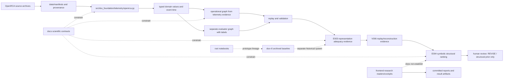

# Distributed Causal Engine workspace map

**Prepared:** 5 November 2026 (Asia/Calcutta)  
**Purpose:** one orientation report describing the repository, its evidence and experiments, the relationships among its major parts, and the exact home of the planned experiment list.

## How to read this report

This report is an orientation map, not a replacement for the governing records or experiment artifacts. It is based on the repository instructions, project checkpoints, permanent register and amendments, the E001–E004 experiment records, E003/V006 and E004/R001 evidence, the 8 October and 4 November research-design records, core scientific contracts, source/package layout, UI and test layout, and the root notebooks. The external-tool notes are based on the three linked repositories' current public pages and README material.

The accessible, non-Git, non-ignored file listing returned 1,241 paths: 23 at the root, 8 under `data`, 20 under `dce-r0`, 2 under `deployment`, 91 under `docs`, 2 under `evaluation`, 4 under `examples`, 967 under `experiments`, 33 under `frontend`, 2 under `models`, 2 under `notebooks`, 1 under `provenance`, 2 under `replay`, 1 under `scrap`, 21 under `scripts`, 2 under `simulator`, 47 under `src`, and 13 under `tests`. A separate recursive filesystem inventory saw 2,972 files, including ignored dependencies, caches, generated data, and bytecode. Several cache/temp directories returned access denied during recursive enumeration. Git internals were excluded. Raw archives and binary payloads are identified by manifests and filenames; they are not described as if every byte had been semantically reviewed. This report therefore maps the whole visible workspace and its file families, while preserving an explicit boundary around ignored/generated/binary content.

## In one sentence

DCE is a research repository for testing whether explicit, versioned representations of distributed services, telemetry, event time, evidence and dependency structure can support defensible component localization; the current implementation is a representation/replay foundation plus a restricted symbolic ranking experiment, while the learned, causal, counterfactual, planning, remediation, self-healing and production capabilities remain gated proposals.

## The system as it exists

The arrows show the evidence flow intended by the code and records. They do not imply that every proposed feature is implemented or scientifically qualified. In particular, E004 ranks structural candidates from a retrospective, oracle-time-conditioned set. It is not an online fault detector and does not establish causation.

### Main areas and their relationships

| Area | What it contains | How it connects | Status boundary |
|---|---|---|---|
| Root guidance and identity | `AGENTS.md`, `EXPERIMENTAL_PROTOCOL.md`, `PROJECT_STATE.md`, `EXPERIMENT_INDEX.md`, their dated amendments | Defines constraints, durable experiment names, current review boundaries, and recovery order | The root checkpoint/index are historical records and conflict with later additive E003/E004 records; see “State and conflicts.” |
| `docs/` | Scientific contracts, methodology, research reports, governance program and 38 stage cards | Explains the research question, assumptions and staged evidence required; points to source and experiment artifacts | Contracts and roadmap do not prove implementation readiness or authorize unregistered work. |
| `src/dce_foundation/` | Current Python foundation: typed domain values, time, graph, OpenRCA adapter/replay, validation, inspection, qualification and representation-v2 components; `symbolic_e004.py` | Reads source data or retained replay artifacts and produces representations/rankings used by E003/E004 | Code presence is not a performance or safety result. E003/V006 and E004/R001 boundaries remain narrow. |
| `experiments/` | Permanent E001–E004 records, E003 qualification/remediation history and result payloads, templates | Binds hypotheses and protocols to configurations, run ledgers, artifacts, interpretations and decisions | Large result count is mainly repeated per-file/per-profile evidence. XP numbers are planning IDs, not experiment IDs. |
| `data/` and `provenance/` | Dataset descriptions, manifests, schema notes, source references and a blocked storage migration preflight | Establishes data identity/provenance for adapters and experiments | Local raw OpenRCA content and processed outputs are not all visible in ordinary source listings; no full-volume or telemetry-semantics claim follows from their existence. |
| `dce-r0/` and root notebooks | Delivered Python R0 package and five historical notebooks | Prior prototype/baseline lineage; provides comparison context for E001/E002 and the foundation | Keep R0 package `dce` distinct from `dce_foundation`. The notebooks are not registered E001 or E002 executions. |
| `frontend/` | Experiment control room, research cockpit, dated reader and evidence update views | Presents recorded experiment state and documentation | Static research interfaces are not the inference engine and do not upgrade a REVISE result. |
| `scripts/`, `tests/`, `examples/` | Audits, validators, analysis/build helpers, tests and a small OTLP intake example | Checks contracts or helps generate/inspect artifacts | A passing test validates only its tested behavior. A governance checker is not an approval authority. |
| `deployment/`, `evaluation/`, `models/`, `replay/`, `simulator/` | Mostly README/scaffold entry points or reserved areas | Marks intended future boundaries and usage | These directories do not establish production deployment, a registered simulator campaign, trained model, or online replay service. |
| `scrap/` | Standalone legacy page | Historical or exploratory content | Not a canonical application route. |

## Source and data flow in more detail

1. **Data identity.** `data/manifests/openrca.json` and the data documentation describe the local OpenRCA snapshot and its provenance. Archives are kept as source material; ignored raw/processed data should not be confused with reviewed, committed results.
2. **Input parsing.** `src/dce_foundation/telemetry/openrca.py` adapts archive records into typed observations while retaining source provenance and raw attributes. Rejections and unknown values remain visible instead of being invented away.
3. **Canonical representation.** `domain.py`, `event_time.py`, and `graph.py` define typed records, time handling, and graph structures. `validation.py` and `inspection.py` check/report representation properties. `replay/openrca.py` provides the bounded CLI replay path.
4. **Evaluation separation.** The protocol keeps labels/root records in evaluator-owned structures, separate from the telemetry-only operational graph. That separation is essential: evaluation labels, fault schedules and score points must not become model inputs.
5. **Qualification/recovery.** E003 qualification modules and dated V001–V006 artifacts preserve schema profiles, continuations, replay checks and independent audits. V006 accepted deterministic replay/reconstruction infrastructure in a limited scope; it did not prove symptoms, full data coverage, RCA accuracy, or causal validity.
6. **E004.** `symbolic_e004.py` and its experiment package implement deterministic graph-based structural ranking over 335 retained oracle-time-conditioned windows and compare it against non-graph references. Predictions were separated from evaluator access and independently audited. The graph method did not beat the observation-count reference.
7. **Presentation.** The frontend reads report/result data to make research state navigable. It does not transform unresolved semantics into qualified inputs, make decisions, or authorize stages.

## Scientific contracts that govern interpretation

The most useful contracts to read alongside the code are:

- [`docs/domain-model.md`](domain-model.md): environment-scoped identities, observations, evidence, decisions, incidents and version references.
- [`docs/telemetry-contract.md`](telemetry-contract.md): measurement unit/kind/temporality, counter resets, histogram rules, raw-versus-normalized values and R0 ingestion limits.
- [`docs/event-time-model.md`](event-time-model.md): event/receipt/processing time, window alignment, lateness, missingness and delay accounting.
- [`docs/graph-ontology.md`](graph-ontology.md): dependency direction, provenance, validity, cycles and the difference between reachability and observed impact.
- [`docs/evaluation-protocol.md`](evaluation-protocol.md): baseline independence, leakage controls, matching and accuracy/coverage distinction.
- [`docs/reasoning-semantics.md`](reasoning-semantics.md): unknown is not healthy; evidence links, uncertainty, contradiction and abstention expectations.
- [`docs/causal-model.md`](causal-model.md), [`docs/planning-model.md`](planning-model.md), and [`docs/safety-model.md`](safety-model.md): future causal, planning and intervention claims require their own assumptions, baselines, controlled evidence and approval.

The common rule is to preserve unknowns. A timestamp, metric name or graph edge cannot acquire meaning just because a downstream method would benefit from one.

## Experiment state: read this timeline before treating a status as current

The repository contains records written at different times. The later records are additive and intentionally do not rewrite the earlier root checkpoint or permanent index. That preserves history but leaves a discoverability inconsistency.

| Date | Record | What it says |
|---|---|---|
| 3 Oct 2026 | Root `PROJECT_STATE.md`, `docs/governance/project-state.json`, `EXPERIMENT_INDEX.md`, and `AGENTS.md` | E001 draft/not run; E002 reserved pending E001 review; E003-R001 adequacy review pending; E004 is next available but unallocated. The next permitted action is E003 review. |
| 4 Oct 2026 | E003 qualification V006 artifacts | Replay/reconstruction repeatability and independent audit passed within the saved scope; scientific/semantic limits remain. |
| 6 Oct 2026 | [`docs/governance/amendments/2026-10-06-E003-V006-acceptance-and-E004-scope.md`](governance/amendments/2026-10-06-E003-V006-acceptance-and-E004-scope.md), [`EXPERIMENT_INDEX_AMENDMENT_2026-10-06_E004.md`](../EXPERIMENT_INDEX_AMENDMENT_2026-10-06_E004.md), and E004 registration | User accepted E003 V006 as representation/replay infrastructure with scientific limitations intact, then authorized E004 symbolic baseline registration. This additive amendment supersedes the old “E004 unallocated” statement for that narrow allocation. |
| 6 Oct 2026 | E004-R001 run and results | 335 cases, deterministic ranking/audit checks; graph Top-1/Top-3 3.08%/8.93%, observation-count reference 4.78%/14.93%, graph-disabled uniform 1.80%/5.41%. The result is a structural prior only, not symptom-grounded RCA. |
| 8 Oct 2026 | [`docs/governance/amendments/2026-10-08-E004-R001-execution-acceptance.md`](governance/amendments/2026-10-08-E004-R001-execution-acceptance.md) | User accepted correct execution and retained **REVISE / structural prior only**. No E005, detector, causal work or remediation was authorized. |
| 8 Oct 2026 | Bounded acquisition and symptom-evidence research design | Authorized bounded, read-only examination of retained evidence and official references. It did not authorize a detector or successor experiment. |
| 4 Nov 2026 | [`docs/research-design/2026-11-04-source-provenance-inventory/report.md`](research-design/2026-11-04-source-provenance-inventory/report.md) | None of 18 selected metric names was fully semantically qualified; no documented healthy-control source or independent evaluation population was found. The OpenRCA detector path stops until those prerequisites exist. |
| 5 Nov 2026 | Appended section in root `PROJECT_STATE.md` | Records a user-directed proposed pivot toward an owned controlled distributed-system testbed, but explicitly says no testbed, fault injector, telemetry pipeline, model, detector, protocol or experiment is registered, implemented or executed under that pivot. |

### Current interpretation and live consistency check

The actual latest scientific evidence in the visible record set is E004-R001: execution accepted, outcome **REVISE / structural prior only**. E003's V006 infrastructure acceptance is a bounded predecessor decision, not a declaration that all E003 domain-adequacy questions passed. The November 4 provenance report further blocks a detector based on the sampled OpenRCA metrics. A controlled testbed pivot is proposed, not yet an experiment.

The records disagree in discoverability: root `EXPERIMENT_INDEX.md` and the October 3 checkpoint still call E004 unallocated and E003 review pending; the 6 October index amendment and registration allocate E004, and the 8 October amendment accepts its execution. `AGENTS.md` still encodes the October 3 barrier and next-action wording. Preserve both layers and consult the explicit dated amendment for the E004 history. Do not claim that a new checker has reconciled the files.

The read-only command `python scripts/check_project_governance.py` currently returns `FAIL: protected content changed: .gitignore`. The preservation manifest records the expected protected hash; Git status also shows `.gitignore` modified and many workspace files untracked. This is a live consistency/working-tree issue. It does not erase the later dated E004 review, and the checker failure does not itself constitute an experiment result or human review.

## The planned experiments: exact document locations and full list

The document to reopen is [`docs/governance/EXECUTION_ROADMAP.md`](governance/EXECUTION_ROADMAP.md), under **“Planning stages (not experiment allocations)”**. The complete machine-readable plan is [`docs/governance/execution-plan.json`](governance/execution-plan.json). Each stage has its own card under [`docs/governance/stages/`](governance/stages/), named `XP001-…` through `XP038-…`. The original source program is retained at [`docs/governance/EXECUTION_PROGRAM_ORIGINAL.md`](governance/EXECUTION_PROGRAM_ORIGINAL.md), and numbering/phase conflicts are explained in [`docs/governance/RECONCILIATION.md`](governance/RECONCILIATION.md).

These XP identifiers are planning keys. They are not permanent E experiment IDs and do not grant execution authority. Only XP001 maps to the existing permanent E003. E001, E002 and E003 keep their permanent meanings from the register. E004 was separately allocated by its 6 October dated amendment. All other XP stages below remain planned and unallocated unless a later authorized amendment says otherwise.

| Planning key | Planned stage | Roadmap phase | Dependency (as listed in roadmap) |
|---|---|---|---|
| XP001 | Domain model adequacy | P01 | Research definition; mapped to permanent E003 |
| XP002 | Telemetry attachment | P03 | XP001 |
| XP003 | Real feature coverage | P03 | XP002 |
| XP004 | Temporal correctness | P04 | XP003 |
| XP005 | Graph correctness | P05 | XP004 |
| XP006 | Topology-only baseline | P06 | XP005 |
| XP007 | Topology plus temporal reasoning | P06 | XP006 |
| XP008 | Topology temporal domain rules | P06 | XP007 |
| XP009 | Contradiction handling | P06 | XP008 |
| XP010 | Multiple simultaneous symbolic faults | P06 | XP008 |
| XP011 | Neural anomaly baseline | P07 | XP009, XP010 |
| XP012 | PyTorch ONNX parity | P07 | XP011 |
| XP013 | Variable service membership | P07 | XP012 |
| XP014 | Fusion ablation | P08 | XP013 |
| XP015 | Remove neural evidence | P08 | XP014 |
| XP016 | Remove topology | P08 | XP014 |
| XP017 | Remove temporal evidence | P08 | XP014 |
| XP018 | Correlation versus causal hypothesis | P09 | XP015, XP016, XP017 |
| XP019 | Controlled intervention | P09 | XP018 |
| XP020 | Causal model comparison | P09 | XP019 |
| XP021 | Counterfactual root-cause test | P10 | XP020 |
| XP022 | Alternative intervention | P10 | XP021 |
| XP023 | Planning validity | P11 | XP022 |
| XP024 | Constraint-aware planning | P11 | XP023 |
| XP025 | Plan optimality | P11 | XP024 |
| XP026 | Recommendation correctness | P12 | XP025 |
| XP027 | Execution correctness | P12 | XP024, XP026 |
| XP028 | Failed remediation | P12 | XP027 |
| XP029 | Single-fault self-healing | P13 | XP028 |
| XP030 | Cascading self-healing failure | P13 | XP029 |
| XP031 | Multiple self-healing faults | P13 | XP029 |
| XP032 | Unsafe-action rejection | P13 | XP029 |
| XP033 | Neural-symbolic event extraction | P14 | XP030, XP031, XP032 |
| XP034 | Neural hypothesis generation | P14 | XP033 |
| XP035 | Neural hallucination rejection | P14 | XP034 |
| XP036 | Crash-safe persistence | P15 | XP035 |
| XP037 | Concurrent workers | P15 | XP036 |
| XP038 | Kafka transition qualification | P15 | XP037; only if measured PostgreSQL queue limits justify comparison |

The roadmap also has P00 research definition and P16–P20 operator interface, final evaluation, robustness, global ablation, and final reporting campaigns. Those are phase objectives with gates, not extra XP allocations. Their scopes require separate preregistration and review. Kafka is conditional, not a mandatory milestone.

## Permanent experiment identities currently in the register/amendments

| Permanent ID | Registered meaning | Evidence/status in repository |
|---|---|---|
| E001 | Reproduce delivered R0 baseline and audit comparison semantics | Draft; run ledger says no runs. The delivered R0 and notebook results predate this ID and are prior evidence only. |
| E002 | Investigate neural/SLO onset provenance and timing contribution | Reserved in the permanent index pending E001 review; separate E002-R001/R002 artifacts exist in the workspace and R002 proposes REVISE for a repeatable null difference across 237 events. Root index/checkpoint discoverability is stale relative to those later artifacts; review status must follow the dated result records, not folder names alone. |
| E003 | Domain model adequacy across OpenRCA systems/scenarios | E003-R001 bounded adequacy run; later V001–V006 qualification/recovery artifacts. V006 representation/replay infrastructure was accepted by the user while scientific restrictions remain. |
| E004 | Symbolic RCA baseline | Additively registered 6 Oct; E004-R001 execution accepted 8 Oct; scientific disposition remains REVISE / structural prior only; no successor allocated. |

## Reading route for understanding the application

For the scientific history, read [`EXPERIMENTAL_PROTOCOL.md`](../EXPERIMENTAL_PROTOCOL.md), then [`EXPERIMENT_INDEX.md`](../EXPERIMENT_INDEX.md) and its dated amendment, then [`PROJECT_STATE.md`](../PROJECT_STATE.md) and the 6 October E004 checkpoint, then E003's hypothesis/protocol/run/decision and V006 artifacts, followed by E004's hypothesis/protocol/configuration/run/summary/audit/decision and the 8 October approval. Read the 4 November source-provenance report last for the latest OpenRCA evidence boundary.

For implementation, read `docs/E003-implementation-report.md`, `src/README.md`, `pyproject.toml`, then `src/dce_foundation/domain.py`, `event_time.py`, `graph.py`, `telemetry/openrca.py`, `replay/openrca.py`, `validation.py`, `evaluation.py`, and the corresponding `tests/`. Follow the separate E004 code path in `src/dce_foundation/symbolic_e004.py` and `scripts/audit_e004.py` into E004's saved inputs/results. Keep this separate from `dce-r0/dce/src/dce/` and root notebooks.

For product intent, read root `PRD.md`, `RESEARCH_QUESTIONS.md`, `ARCHITECTURE.md`, and `README.md`, then scientific contracts. For interface intent, read each `frontend/*/README.md` and the dated frontend audit; follow its JavaScript data imports back to report/result artifacts. For validation tooling, read each script's docstring/arguments and matched tests. A README under `deployment`, `evaluation`, `models`, `replay` or `simulator` is a scope marker unless backed by concrete modules and reviewed evidence.

## The linked tools and how they fit this request

| Repository | Useful role for this workspace | What it cannot decide |
|---|---|---|
| [Graphify](https://github.com/Graphify-Labs/graphify) | Produces a queryable code/document knowledge graph, with edges labeled as source-extracted or inferred. Its README says source parsing is local and deterministic, while semantic processing of documents/media may use a configured model. This is a good complement for tracing Python imports, Markdown links, scripts and governance references. | A generated graph is a navigation aid, not proof of experiment validity or a replacement for reading scientific records. The local `graphify` package/skill was not installed in this task; no generated graph artifacts are claimed. |
| [Floorplan](https://github.com/haydenschmitty/floorplan) | Presents an interactive plain-English map of application areas, files, endpoints and requests. Its README describes local maps and incremental updates. This can help explain the application to a reader who wants a visual overview. | The workspace includes static research pages and prototypes, not a verified production app/API. A generated floorplan would need to reflect that distinction. Floorplan was not installed or run here. |
| [OpenResearch](https://github.com/alphaXiv/OpenResearch) | Describes a local-first research-agent environment that stores experiments, logs, code and artifacts locally and can run on local/remote compute. It may help organize a future authorized research workflow. | It does not replace DCE's permanent experiment register, frozen protocol, data provenance, human gate or no-overwrite policy. It was not installed/launched here. The current E004 and 4 November evidence do not authorize a successor run. |

The repository's own rules make human gate review and prior registration prerequisites. The latest permitted work evidenced here is to review the E004 result and the source-provenance stopping report, then obtain a separately recorded user decision before any new controlled-testbed experiment is registered. A proposal to pivot datasets does not itself create an experiment ID or authorize implementation/execution.

## File inventory boundaries and artifact interpretation

- The 967 visible paths under `experiments/` are not 967 experiments. The count includes experiment records, many small result JSON files, per-file profiles, source snapshots, logs and repeated V006/E004 audit artifacts. Permanent experiments are E001–E004; the XP001–XP038 cards are plans.
- Root has five notebooks: four similarly named `distributed-causal-engine-ntbk1*` lineage variants plus `DCE_Final.ipynb`. They are historical prototypes; notebook output and code do not register an experiment.
- `dce-r0.zip` and `experiments/E003_domain_model_adequacy/results/E003-R001/source-snapshot.zip` are binary archives. Read their manifests/hashes before relying on them; do not overwrite or unpack over originals.
- The raw OpenRCA archives and retained SQLite/processed payloads may be ignored by Git and do not appear in the ordinary visible-file count. The 4 November qualification report explicitly says it did not read raw telemetry payloads.
- The 2,972-file recursive count includes ignored Python environments, caches, bytecode, compressed files, generated/replay material and data artifacts. Several temp/cache paths denied recursive reads. Those are not first-party source modules and must not be mistaken for application behavior.
- Current Git status contains a modified `.gitignore`, modified `README.md`, and many untracked repository trees/files. No commit or push was made for this report.

## Current permitted next step

Read the roadmap again at [`docs/governance/EXECUTION_ROADMAP.md`](governance/EXECUTION_ROADMAP.md); the full list is reproduced above. Then review E004-R001's result proposal with the 4 November provenance inventory and decide whether the project remains on OpenRCA, pursues the proposed owned testbed, or takes another direction. Any new work that creates a new experiment or changes existing source/records requires the separately scoped authorization and governance steps stated in `AGENTS.md` and the experiment constitution.

